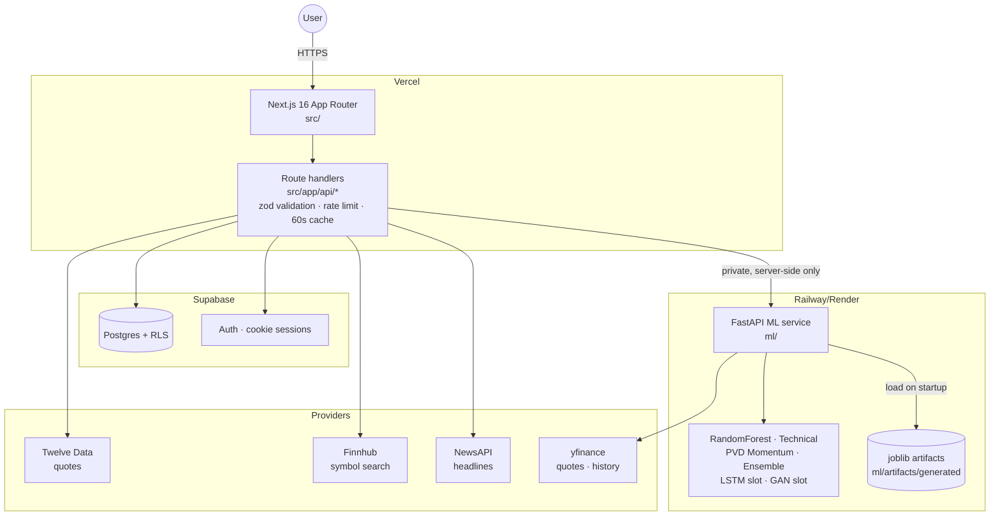

# Architecture

Roneira AI HIFI is an AI-assisted financial intelligence platform: live market data, ML
price projections, portfolio and watchlist tracking, and an append-only audit trail.

The maintained runtime surfaces are Next.js, FastAPI and Supabase. The `data/`
project and disposable database/Auth tests support them in CI; see
[Canonical surfaces](#canonical-surfaces).

## System shape



Browser market-data and prediction calls go through Next.js routes. The FastAPI
service is publicly reachable by its server caller; `X-ML-Service-Token` protects
its data/inference endpoints. CORS is not that access boundary. `/` and `/health`
remain public. Prediction additionally requires the Supabase user session.
Browser Supabase clients also call Auth and private tables directly under RLS.

## Canonical surfaces

| Surface | Deploys to |
|---|---|
| `src/` — Next.js 16 app | Vercel |
| `ml/` — FastAPI ML service | Railway/Render |
| `supabase/` — migrations | Supabase (hosted) |

`data/` contains the dataset registry, synthetic fixtures and validators. Earlier
Vite/Express/Socket.IO and alternate ML services were removed; Git history
preserves them. They are not supported startup paths.

Local Supabase and disposable PostgreSQL/GoTrue integration tests use Docker.
The web and ML development servers run directly; there is no maintained Compose
stack for them. [CI](.github/workflows/ci.yml) checks web/build, ML, data,
disposable database migrations/RLS, real GoTrue deletion, security scans and
required deployment files. Hosted availability needs separate verification.
The [native pre-commit hook](.husky/pre-commit) runs web checks and conditional
ML/data checks. [Contributing](CONTRIBUTING.md) explains the workflow.

## Frontend (`src/`)

- **Next.js 16** App Router, **React 19**, TypeScript.
- **Tailwind v4** with CSS-first `@theme` tokens in `src/app/globals.css`. Dark-first.
- **State**: `zustand` (`src/lib/stores/app-store.ts`) for UI state — sidebar, theme,
  command palette, current user. **TanStack Query** for all server data
  (`src/lib/hooks/*`), which owns caching, retries, and refetch intervals.
- **Charts**: `lightweight-charts` for price/candles, `recharts` for allocation panels.
- **Layout**: `src/app/dashboard/layout.tsx` mounts `Sidebar`, `Header`, and
  `CommandPalette`. The palette's open state lives in the store so the header button and
  ⌘K/Ctrl+K drive one value — keeping it in local component state left the button wired
  to nothing.

```
src/app/         routes: api/, dashboard/, login/, signup/
src/components/  auth/ charts/ prediction/ shared/ ui/
src/lib/         client/ server/ market/ news/ stores/ supabase/ hooks/
```

### Design direction

Shared CSS tokens provide dark/light backgrounds, brass accents and semantic
profit/loss/warning colors. Instrument Serif is used for titles, with Geist and
monospace for interface labels and numeric data. The dashboard has a desktop sidebar,
native mobile navigation dialog and reduced-motion behavior.

Prediction selection uses labelled native controls and descriptions of each method.
Results explain the actual backend, requested/trained horizon and input daily session.
An unavailable model shows a neutral no-change reference and omits forecast/signal
visualizations; excluded ensemble members are listed separately from the target axis.
Component tests cover these states; dated browser/accessibility evidence is in
the [model-design review](docs/model-design-review-2026-10-11.md). Synthetic browser
fixtures do not verify hosted authentication.

## API route handlers (`src/app/api/`)

| Route | Purpose | Caller boundary |
|---|---|---|
| `auth/username` GET/POST | availability and username/password login | anonymous, rate limited |
| `predict` POST | ML prediction and eligible forecast/audit persistence | authenticated session |
| `market-data` GET | quote groups or symbols | public, rate limited |
| `market-data/history` GET | OHLCV candles | public, rate limited |
| `screener` GET | ML-backed stock screener | public, rate limited |
| `stocks/search`, `news` GET | symbol search and classified headlines | public, rate limited |
| `portfolio/history` GET/POST | private server-valued portfolio captures | authenticated owner |
| `audit-log` POST | bounded client-reported activity for the verified actor | authenticated session |
| `admin/overview` GET | admin dashboard data | administrator role |
| `cron/alerts` GET | scheduled atomic price-alert evaluation | private cron bearer secret |

Validation lives in `src/lib/server/validation.ts`. Audit enums mirror the
Postgres `CHECK` constraints; prediction selections match supported FastAPI models
(the database also accepts the retired `FUNDAMENTAL` name). Bad input fails as a 400 at
the edge instead of surfacing as a 500 from the database. Audit payloads are capped at
16 KB — they are attacker-influenced JSON landing in an append-only table.

Rate limiting (`src/lib/server/rate-limit.ts`) is a fixed window over the Upstash REST
API, called with plain `fetch` rather than an SDK. Without Upstash credentials it falls
back to an in-process window: real, but per-instance, so on serverless it limits per warm
instance rather than globally. Redis is what makes the limit global.

Every outbound server-side `fetch` carries an `AbortSignal.timeout`. This is deliberate —
an unbounded fetch to a wedged upstream hangs the route forever.

## Data providers and fallback chain

Quotes resolve in this order (`src/lib/server/market.ts`):

1. **Twelve Data** for every symbol it can serve.
2. Symbols it misses fall through to the **ML service** `/market-data`, which reads
   **yfinance**.

Results cache for 60s, so the chain runs on a cache miss. Fallback still depends
on the ML URL, matching token and provider availability. Quote failures can
currently become an empty successful response; history failures surface as a
generic error. [#213](https://github.com/aaron-seq/Roneira-AI-HIFI/issues/213) tracks
safer classification while preserving usable partial results.

- **Finnhub** — symbol search, with Alpha Vantage as fallback. Results are deduplicated by
  symbol; providers return the same ticker under several descriptions.
- **NewsAPI** — headlines, classified for sentiment in `src/lib/news/classify.ts`.

Two yfinance constraints, both learned the hard way:

- **Keep `yfinance >= 0.2.51`.** Older releases fetch through plain `requests`, which
  Yahoo blocks on UA/TLS fingerprint — it returns HTML and every parse fails with
  `Expecting value: line 1 column 1`. From 0.2.51 it uses `curl_cffi` and impersonates a
  browser.
- **Yahoo appends a placeholder row with NaN OHLC** for the most recent session. The
  serving path (`ml/app/main.py::fetch_stock_data`) and the training path
  (`train_models.py::fetch_training_frames`) both drop it. A NaN close otherwise
  propagates into price reads, model features, and JSON encoding — and `NaN` is not valid
  JSON.

## ML service (`ml/`)

FastAPI on uvicorn. Route handlers are **sync `def`, not `async def`**, on purpose: they
do blocking network and CPU work, and as coroutines they starved the event loop badly
enough to make the whole service unresponsive. As `def`, FastAPI runs them in a
threadpool. `/market-data` additionally fans out across symbols with a
`ThreadPoolExecutor` — fetching 16 symbols serially took long enough that callers timed
out first.

| Model | Kind | Trained? |
|---|---|---|
| `RANDOM_FOREST` | sklearn RandomForest, refit per request with label-resolution-purged TimeSeriesSplit | yes, requested session horizon |
| `TECHNICAL` | rule-based indicators (RSI, MACD, Bollinger, EMA, Stochastic, ADX, Supertrend, Ichimoku, Anchored VWAP) | n/a — deterministic |
| `PVD_MOMENTUM` | price/volume/divergence momentum engine | n/a — deterministic |
| `LSTM` slot | gradient-boosted (xgboost), 60-step feature windows | yes, offline artifact |
| `GAN` slot | gradient-boosted (xgboost), 30-step feature windows | yes, offline artifact |
| `ENSEMBLE` | equal blend of compatible RF / Technical / PVD / LSTM members | n/a |

`ENSEMBLE` returns a `components` array alongside the blended `predicted_price` — each
constituent's own price target, heuristic score, weight, signal, backend and trained
session horizon — plus `agreement_score`
and `price_spread`. The blend alone hides disagreement between models; the Predict UI's
`ModelSpread` component (`src/components/prediction/ModelSpread.tsx`) plots the
constituents against spot so a case like "Technical says buy while targeting a price below
spot" is visible rather than averaged away. `excluded_components` records failed or
unsupported members, which receive no weight. Agreement/proximity is descriptive and
does not increase confidence. Every response includes daily input provenance and
fallback state; a fallback is audited but not inserted into forecast history/cache.

**TensorFlow is not a dependency.** Both sequence slots use XGBoost bundles and
retain their compatibility names. They are not recurrent LSTM or generative GAN
networks. TensorFlow training is disabled. The four reviewed bundle/metadata files
under `ml/artifacts/generated/` are committed for startup without offline fitting;
provider data fetches are still required and Random Forest fits per request.

Only trusted artifacts may be loaded: joblib/pickle can execute code. A bundle's
feature/window schema and trained session horizon must match the request; feature
padding and unsupported-horizon promotion are rejected. Keep candidate training
separate from deployed artifacts. Staleness or a successful fit is not promotion
approval.

The [model guide](ml/MODELS.md) owns feature, horizon, purging and evaluation
contracts. The shipped 30-session bundles did worse than no change in their
recorded held-out assessment. The [frozen real-market study](ml/research/results-2026-10-19.md)
did not justify promoting a candidate. Older benchmark caveats are retained in
[the model reference](ml/MODELS.md#historical-benchmark-caveat); no trading edge or
position-sizing recommendation follows from those results.

## Database (Supabase Postgres)

Migrations in `supabase/migrations/`, applied in filename order (there is no `004`).

| Table | Notes |
|---|---|
| `users` | profile keyed to `auth.users.id`; `role` is `admin`/`user` |
| `watchlist` | unique per `(user_id, ticker)` |
| `portfolio_holdings` | unique per `(user, ticker)`; editable current positions, not a complete transaction/cash-flow ledger |
| `portfolio_transactions` | `total_value` is a generated column; the current holdings UI does not maintain a complete ledger |
| `portfolio_valuation_snapshots` | private per-user/currency/UTC-day aggregate captures; server-calculated value/cost, coverage and source metadata |
| `audit_log` | append-only |
| `predictions_cache` | short-lived, `expires_at` |
| `prediction_history` | durable forecast records; exchange-session outcome dates remain tracked in issue157 |
| `news_preferences` | per-user feed configuration |
| `market_data.stock_prices` | OHLCV cache; backend-only, RLS off by design |

Portfolio history uses authenticated `GET/POST /api/portfolio/history`. Reads
are filtered to the signed-in owner under RLS. A POST accepts only currency,
reads that user's current holdings, fetches quotes/FX, rechecks for edits and
values the book with the shared finite-value calculator. Service-only
`save_portfolio_valuation_snapshot` guards same-day writes by capture time so
an older delayed request cannot replace a newer one. A separate holdings
observation time records which current book was read; this is an observation,
not an atomic broker ledger. Aggregate captures do not retain each historical
position's quantity/price/basis. Missing days and partial valuation stay explicit.

The client scopes queries/mutations to account identity and checks the active
session before and after requests. Opening the portfolio attempts a capture
once when the current UTC day is missing; explicit saving updates today's row.
There is no unattended daily scheduler or backfill. Recorded cost/current value
and unrealized P&L exclude realized gains and cash-flow-adjusted returns.

RLS is enabled on every `public` table. Two constraints worth knowing:

- **An admin policy must not query `users` from a policy on `users`.** That recursed
  (`42P17`) and broke every request touching those tables, not just admin ones, because
  Postgres ORs all permissive policies together. Admin checks route through the
  `SECURITY DEFINER` function `public.is_admin()` (migration 007).
- **`anon` needs a SELECT policy on `users`** exposing only `id` and `username`
  (migration 008). Username login and the signup availability check read that table as
  anon; without the policy anon sees zero rows, so every username looks free and every
  login looks like a wrong password.

Migration014 removes the permissive audit INSERT policy and direct INSERT grants
from `anon` and `authenticated`. Session-verified server routes use the admin client
to append actor-bound records; signup/portfolio/watchlist triggers write as their
owner. SELECT RLS remains account-scoped. Migration 015 permits only nested
nonnull→null live-profile unlinking when the actual parent is absent and every
other event field is unchanged. Normal portfolio/watchlist deletes retain their
live actor; account cascades record a null link and unchanged OLD evidence.
Other UPDATE/DELETE operations remain rejected even for `service_role`, which
otherwise bypasses RLS. This repairs #174; it is not erasure of audit JSON or
existing unlinked forecast history. [ADR 0002](docs/adr/0002-audit-retention-on-account-deletion.md)
records the contract and unresolved policy #196. Client-reported events are not
independent proof that the named operation occurred.

## Auth

Supabase Auth with cookie sessions via `@supabase/ssr`.

- Signup creates the `auth.users` row; the `handle_new_user` trigger creates the matching
  `public.users` profile, default `news_preferences`, and a `SIGNUP` audit row.
- Login is **username**-based: `auth/username` POST resolves username → email via the anon
  client, then calls `signInWithPassword`. The email lookup uses the admin client, so
  `SUPABASE_SERVICE_ROLE_KEY` is required for login to work at all.
- Triggers also write audit rows for portfolio and watchlist changes, so the trail does
  not depend on the client remembering to log.

## Environment

The [README configuration table](README.md#configuration) and [.env.example](.env.example)
define the environment variables. Hosting requires an actual server-side
`ML_BACKEND_URL` and the same private `ML_SERVICE_TOKEN` on both services; a local
localhost default is not a deployed backend. A healthy ML process does not prove
that token-protected provider calls succeed.

Provider permissions, quotas and optional Upstash configuration affect coverage
and rate limiting. Hosted setup, migration ordering, cold-start limits and
recovery are documented in [Deployment](DEPLOYMENT.md). Installation, startup
and test commands are maintained in the [README](README.md#getting-started).

## Commands

Use the [README quickstart](README.md#getting-started) and
[validation commands](README.md#training-and-testing) for the maintained command list.

## Guardrails

| Guardrail | Where | How |
|---|---|---|
| Request validation | every mutating route | zod schemas mirroring DB `CHECK` constraints |
| Rate limiting | login, search, news, predict | fixed window, Upstash REST + in-process fallback |
| Outbound timeouts | all server-side `fetch` | `AbortSignal.timeout` |
| Row-level security | all `public` tables | Supabase RLS; admin via `is_admin()` |
| Append-only audit | `audit_log` | no DELETE policy + DB triggers |
| ML service isolation | server-to-server calls | private token on protected routes; browser calls Next.js |
| Error boundaries | React UI | `src/components/ui/ErrorBoundary.tsx` |
| Pre-commit | git | type-check, lint, web tests, conditional ML/data checks |

Volatile market prices are **not** persisted to Supabase. They live in the 60s in-memory
cache; `market_data.stock_prices` holds historical OHLCV only.

## Related documentation

- [README.md](./README.md) — project overview and setup
- [CONTRIBUTING.md](./CONTRIBUTING.md) — contribution guidelines
- [DEPLOYMENT.md](./DEPLOYMENT.md) — deployment instructions
- [Product plan and PRDs](docs/product/README.md) — current scope, acceptance gates and delivery decisions
