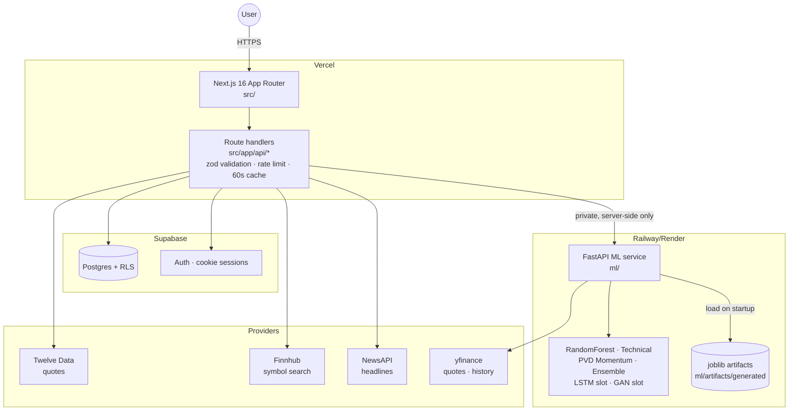

# Architecture

Roneira AI HIFI is an AI-assisted financial intelligence platform: live market data, ML
price projections, portfolio and watchlist tracking, and an append-only audit trail.

Two trees are built, tested, and deployed. Everything else in the repo root is legacy
reference material and is **not** wired into CI — see [Canonical surfaces](#canonical-surfaces).

## System shape



The ML service is never exposed to the browser. All ML traffic goes through
`src/app/api/predict`, which checks the user session and validates the payload before forwarding.

## Canonical surfaces

| Surface | Deploys to |
|---|---|
| `src/` — Next.js 16 app | Vercel |
| `ml/` — FastAPI ML service | Railway/Render |
| `supabase/` — migrations | Supabase (hosted) |

These are the only surfaces. The earlier `frontend/` (Vite + React), `backend/`
(Express), `ml-service/` (Flask/FastAPI), `realtime/` (Socket.IO) and
`infrastructure/` (TimescaleDB init scripts) trees, along with
`docker-compose.yml`, were deleted — they were never built, tested, or deployed,
and nothing in `src/` or `ml/` referenced them. Git history has them if a
decision needs revisiting.

There is **no Docker path**. `docker-compose.yml` composed only the legacy
services and had no service for `src/` or `ml/` at all, so following it built
the dead stack. Local development is `npm run dev` plus `npm run ml:dev`.

CI is `.github/workflows/ci.yml`, covering `src/` and `ml/`. There is no second workflow —
the old `continuous-integration.yml` targeted the legacy trees and had a corrupted first
line that made it unparseable, so it was deleted.

`.husky/pre-commit` runs type-check, lint, and the web tests, plus `ml/` pytest when `ml/`
files are staged.

## Frontend (`src/`)

- **Next.js 16** App Router, **React 19**, TypeScript.
- **Tailwind v4** with CSS-first `@theme` tokens in `src/app/globals.css`. Dark-first.
- **State**: `zustand` (`src/lib/stores/app-store.ts`) for UI state — sidebar, theme,
  command palette, current user. **TanStack Query** for all server data
  (`src/lib/hooks/*`), which owns caching, retries, and refetch intervals.
- **Charts**: `lightweight-charts` for price/candles, `recharts` for allocation panels.
- **Layout**: `src/app/dashboard/layout.tsx` mounts `Sidebar`, `Header`, and
  `CommandPalette`. The palette's open state lives in the store so the header button and
  ⌘K/Ctrl+K drive one value — keeping it in local component state left the button wired
  to nothing.

```
src/app/         routes: api/, dashboard/, login/, signup/
src/components/  auth/ charts/ prediction/ shared/ ui/
src/lib/         client/ server/ market/ news/ stores/ supabase/ hooks/
```

### Design direction

Shared CSS tokens provide dark/light backgrounds, brass accents and semantic
profit/loss/warning colors. Instrument Serif is used for titles, with Geist and
monospace for interface labels and numeric data. The dashboard has a desktop sidebar,
native mobile navigation dialog and reduced-motion behavior.

Prediction selection uses labelled native controls and descriptions of each method.
Results explain the actual backend, requested/trained horizon and input daily session.
An unavailable model shows a neutral no-change reference and omits forecast/signal
visualizations; excluded ensemble members are listed separately from the target axis.
Component tests plus Chromium keyboard, mobile layout and axe checks validate the
changed research states. Synthetic browser fixtures do not verify hosted authentication.

## API route handlers (`src/app/api/`)

| Route | Purpose | Auth | Rate limit |
|---|---|---|---|
| `auth/username` GET | username availability | anon | 20/min |
| `auth/username` POST | username + password login | anon | 10/min |
| `predict` POST | forward to ML, persist eligible forecast/audit fallback | required | 20/min |
| `market-data` GET | quotes by `group` or `symbols` | none | — |
| `market-data/history` GET | OHLCV candles | none | — |
| `stocks/search` GET | symbol search | none | 30/min |
| `news` GET | headlines + sentiment | none | 30/min |
| `audit-log` POST | append validated client-reported activity for the verified actor | required | 30/min |
| `admin/overview` GET | admin dashboard data | admin role | — |

Validation lives in `src/lib/server/validation.ts`. Audit enums mirror the
Postgres `CHECK` constraints; prediction selections match supported FastAPI models
(the database also accepts the retired `FUNDAMENTAL` name). Bad input fails as a 400 at
the edge instead of surfacing as a 500 from the database. Audit payloads are capped at
16 KB — they are attacker-influenced JSON landing in an append-only table.

Rate limiting (`src/lib/server/rate-limit.ts`) is a fixed window over the Upstash REST
API, called with plain `fetch` rather than an SDK. Without Upstash credentials it falls
back to an in-process window: real, but per-instance, so on serverless it limits per warm
instance rather than globally. Redis is what makes the limit global.

Every outbound server-side `fetch` carries an `AbortSignal.timeout`. This is deliberate —
an unbounded fetch to a wedged upstream hangs the route forever.

## Data providers and fallback chain

Quotes resolve in this order (`src/lib/server/market.ts`):

1. **Twelve Data** for every symbol it can serve.
2. Symbols it misses fall through to the **ML service** `/market-data`, which reads
   **yfinance**.

A Twelve Data outage degrades to fully yfinance-sourced data rather than an empty
response. Results cache for 60s, so the chain only runs on a miss.

- **Finnhub** — symbol search, with Alpha Vantage as fallback. Results are deduplicated by
  symbol; providers return the same ticker under several descriptions.
- **NewsAPI** — headlines, classified for sentiment in `src/lib/news/classify.ts`.

Two yfinance constraints, both learned the hard way:

- **Keep `yfinance >= 0.2.51`.** Older releases fetch through plain `requests`, which
  Yahoo blocks on UA/TLS fingerprint — it returns HTML and every parse fails with
  `Expecting value: line 1 column 1`. From 0.2.51 it uses `curl_cffi` and impersonates a
  browser.
- **Yahoo appends a placeholder row with NaN OHLC** for the most recent session. The
  serving path (`ml/app/main.py::fetch_stock_data`) and the training path
  (`train_models.py::fetch_training_frames`) both drop it. A NaN close otherwise
  propagates into price reads, model features, and JSON encoding — and `NaN` is not valid
  JSON.

## ML service (`ml/`)

FastAPI on uvicorn. Route handlers are **sync `def`, not `async def`**, on purpose: they
do blocking network and CPU work, and as coroutines they starved the event loop badly
enough to make the whole service unresponsive. As `def`, FastAPI runs them in a
threadpool. `/market-data` additionally fans out across symbols with a
`ThreadPoolExecutor` — fetching 16 symbols serially took long enough that callers timed
out first.

| Model | Kind | Trained? |
|---|---|---|
| `RANDOM_FOREST` | sklearn RandomForest, refit per request with label-resolution-purged TimeSeriesSplit | yes, requested session horizon |
| `TECHNICAL` | rule-based indicators (RSI, MACD, Bollinger, EMA, Stochastic, ADX, Supertrend, Ichimoku, Anchored VWAP) | n/a — deterministic |
| `PVD_MOMENTUM` | price/volume/divergence momentum engine | n/a — deterministic |
| `LSTM` slot | gradient-boosted (xgboost), 60-step feature windows | yes, offline artifact |
| `GAN` slot | gradient-boosted (xgboost), 30-step feature windows | yes, offline artifact |
| `ENSEMBLE` | equal blend of compatible RF / Technical / PVD / LSTM members | n/a |

`ENSEMBLE` returns a `components` array alongside the blended `predicted_price` — each
constituent's own price target, heuristic score, weight, signal, backend and trained
session horizon — plus `agreement_score`
and `price_spread`. The blend alone hides disagreement between models; the Predict UI's
`ModelSpread` component (`src/components/prediction/ModelSpread.tsx`) plots the
constituents against spot so a case like "Technical says buy while targeting a price below
spot" is visible rather than averaged away. `excluded_components` records failed or
unsupported members, which receive no weight. Agreement/proximity is descriptive and
does not increase confidence. Every response includes daily input provenance and
fallback state; a fallback is audited but not inserted into forecast history/cache.

**TensorFlow is not a dependency.** The LSTM and GAN slots were written against Keras;
without TF they served an untrained heuristic. They are now backed by
`app/models/gradient_boost.py`, which wraps an `XGBRegressor` in an adapter exposing the
narrow Keras surface the existing inference code calls (`predict(x, verbose=0)[0][0]`), so
each slot keeps its own feature engineering and signal thresholds. Inference loads
only gradient-boosted bundles; TensorFlow training is disabled pending corrected
preprocessing and purged validation. Artifacts and metadata both bind the origin-inclusive
window schema and training horizon. Feature shapes are rejected rather than padded.
Readiness requires a compatible bundle; 30-session artifacts cannot forecast 7 sessions.

The shared history policy is `max(504, 4 * horizon + 200)` observed sessions, fetched
with a calendar-history buffer and bounded before inference. Sequence validation and
RF validation purge by actual label-resolution timestamps. Details and the reproducible
Indian-equity diagnostic are in [ml/MODELS.md](ml/MODELS.md).

Artifacts live in `ml/artifacts/generated/` (override with `ML_MODEL_DIR`) and come from
`python train_models.py`. Loading uses joblib/pickle, so it must only ever read artifacts
this project produced — never a user upload.

**The four generated files (`lstm_gbm.joblib`, `lstm_metadata.json`, `gan_gbm.joblib`,
`gan_metadata.json`) are committed to git**, not gitignored — deliberately, and only these
four (`.gitignore` excludes everything else under `ml/artifacts/generated/` plus any
`.h5`/`.keras`/`.pkl`). At ~500KB each this is trivial for git; no LFS needed. This matters
for deployment: Render's free web-service tier has no persistent disk and spins down after
15 minutes idle, so training at boot would mean retraining on every cold start against a
yfinance/Yahoo connection that's already proven to rate-limit by IP (see above). Committing
the artifacts means the service boots with real trained models and zero live network calls
for inference — free-tier hosting and genuinely trained models are not in tension here.
Railway, for reference, has no ongoing free tier as of this writing (one-time $5 trial
credit, then usage-based billing) — Render is the free-tier-compatible target of the two
named in this doc. Regenerate with `npm run train:ml` and commit the refreshed files when
the data goes stale enough to matter.

> **Superseded by walk-forward results.** The single-split figures below were the best
> available until `ml/backtest.py` (#144). Across 10 periods from 1934 to 2026, neither slot
> beats "no change": LSTM slot −0.049, GAN slot −0.037, each positive in only 4 of 10
> periods. See [ml/MODELS.md](./ml/MODELS.md#walk-forward-results-144). The history below
> is kept because the defects it describes were real and are fixed.
>
> **Measured skill — read before trusting these numbers.** Both gradient-boosted slots
> report a small positive `skill_vs_no_change`: **0.036** (LSTM slot, validation MAE 0.0711
> vs a 0.0738 "no change" baseline) and **0.029** (GAN slot, 0.0717 vs 0.0738), measured on
> a held-out final 20% *of dates* with a 47-calendar-day purge at the boundary. A 3–3.6%
> error reduction at a 30-day horizon is a real edge and a thin one; treat the confidence
> score (≈41.6) as the honest read, and do not size a position on either slot alone. The
> Ensemble weights the LSTM slot at 0.15 — see the comment in `main.py` for why that did not
> move. Re-check `artifacts/generated/*_metadata.json` after any retrain.
>
> **The purge is in calendar days, not rows, and that distinction is load-bearing.** The
> pool is date-sorted, so all nine tickers contribute a window for the same date. A 30-*row*
> purge therefore spanned 2018-04-09 to 2018-04-12 — two trading sessions against a
> thirty-session label — leaving roughly 28 sessions of overlap in training. `purge_days`
> now clears a real time gap (`horizon_days * 7 / 5 + 5`, generous because market holidays
> widen sessions-to-calendar), and `purged_rows` in the metadata records how many rows that
> removed: 296 and 282, versus 30 before. Correcting it moved the reported skill from 0.035
> to 0.036 (LSTM) and 0.030 to 0.029 (GAN) — i.e. **the earlier figures were not materially
> inflated**; the leak mattered for correctness, not for the headline. Do not read the fix
> as having rescued a bad number.
>
> These numbers replace a previously reported `skill_vs_no_change: 0.0`. Three defects were
> responsible, all of them in how the data reached the booster rather than in the booster:
>
> 1. **The top feature was a function of the caller's `period=` argument.**
>    `close_norm = Close / Close.iloc[0]` carried the highest importance in both models
>    (0.31 GAN, 0.18 LSTM). Training fetched `period="max"`; `main.py` serves `"1y"`/`"2y"`.
>    The same session scored ≈8.8 during training and ≈1.4 in production, so production
>    inputs landed outside the range the split points were fitted for. Measured directly:
>    the same 30 sessions predicted −3.1% at training depth and −1.2% at serving depth.
>    Replaced by `Close / Close.rolling(150).mean()` — causal, and identical at any fetch
>    depth a 1-year window can supply.
> 2. **The LSTM slot's `_normalize` was a frame-wide min-max**, applied before windowing.
>    Every training window was therefore scaled by statistics that included its own future,
>    and the divisor differed between a 25-year fit frame and a 1-year serving frame. The
>    tree path no longer normalises at all; the remaining features are ratios and returns,
>    and a tree only needs the scale it was fitted on. `_normalize` stays for the Keras path.
> 3. **The "chronological" 80/20 split was a ticker holdout.** `build_training_windows`
>    appended frame after frame, so the last 20% of rows was the last few *tickers*, not the
>    last few years. Windows are now sorted by date across all frames, and `fit_windows`
>    purges `horizon_days` rows at the boundary so no training label resolves inside the
>    validation period.
>
> `ml/tests/test_training.py::TestFeatureDepthInvariance` fails if (1) or (2) returns;
> `TestChronologicalPooling` fails if (3) does. Both were confirmed to fail against the old
> code before being committed. Retraining also went from 502s to 24s for the LSTM slot
> (`tree_method="hist"`).

## Database (Supabase Postgres)

Migrations in `supabase/migrations/`, applied in filename order (there is no `004`).

| Table | Notes |
|---|---|
| `users` | profile keyed to `auth.users.id`; `role` is `admin`/`user` |
| `watchlist` | unique per `(user_id, ticker)` |
| `portfolio_holdings` | unique per `(user, ticker)`; editable current positions, not a complete transaction/cash-flow ledger |
| `portfolio_transactions` | `total_value` is a generated column; the current holdings UI does not maintain a complete ledger |
| `portfolio_valuation_snapshots` | private per-user/currency/UTC-day aggregate captures; server-calculated value/cost, coverage and source metadata |
| `audit_log` | append-only |
| `predictions_cache` | short-lived, `expires_at` |
| `prediction_history` | durable forecast records; exchange-session outcome dates remain tracked in issue157 |
| `news_preferences` | per-user feed configuration |
| `market_data.stock_prices` | OHLCV cache; backend-only, RLS off by design |

Portfolio history uses authenticated `GET/POST /api/portfolio/history`. Reads
are filtered to the signed-in owner under RLS. A POST accepts only currency,
reads that user's current holdings, fetches quotes/FX, rechecks for edits and
values the book with the shared finite-value calculator. Service-only
`save_portfolio_valuation_snapshot` guards same-day writes by capture time so
an older delayed request cannot replace a newer one. A separate holdings
observation time records which current book was read; this is an observation,
not an atomic broker ledger. Aggregate captures do not retain each historical
position's quantity/price/basis. Missing days and partial valuation stay explicit.

The client scopes queries/mutations to account identity and checks the active
session before and after requests. Opening the portfolio attempts a capture
once when the current UTC day is missing; explicit saving updates today's row.
There is no unattended daily scheduler or backfill. Recorded cost/current value
and unrealized P&L exclude realized gains and cash-flow-adjusted returns.

RLS is enabled on every `public` table. Two constraints worth knowing:

- **An admin policy must not query `users` from a policy on `users`.** That recursed
  (`42P17`) and broke every request touching those tables, not just admin ones, because
  Postgres ORs all permissive policies together. Admin checks route through the
  `SECURITY DEFINER` function `public.is_admin()` (migration 007).
- **`anon` needs a SELECT policy on `users`** exposing only `id` and `username`
  (migration 008). Username login and the signup availability check read that table as
  anon; without the policy anon sees zero rows, so every username looks free and every
  login looks like a wrong password.

Migration014 removes the permissive audit INSERT policy and direct INSERT grants
from `anon` and `authenticated`. Session-verified server routes use the admin client
to append actor-bound records; signup/portfolio/watchlist triggers write as their
owner. SELECT RLS remains account-scoped. Migration009 rejects UPDATE/DELETE even
for `service_role`, which otherwise bypasses RLS. This immutability still conflicts
with account-deletion referential maintenance (#174); insertion hardening does not
resolve that lifecycle defect. Client-reported events are not independent proof
that the named operation occurred.

## Auth

Supabase Auth with cookie sessions via `@supabase/ssr`.

- Signup creates the `auth.users` row; the `handle_new_user` trigger creates the matching
  `public.users` profile, default `news_preferences`, and a `SIGNUP` audit row.
- Login is **username**-based: `auth/username` POST resolves username → email via the anon
  client, then calls `signInWithPassword`. The email lookup uses the admin client, so
  `SUPABASE_SERVICE_ROLE_KEY` is required for login to work at all.
- Triggers also write audit rows for portfolio and watchlist changes, so the trail does
  not depend on the client remembering to log.

## Environment

Copy `.env.example` to `.env.local`.

**Required:** `NEXT_PUBLIC_SUPABASE_URL`, `NEXT_PUBLIC_SUPABASE_ANON_KEY`,
`SUPABASE_SERVICE_ROLE_KEY`, `ML_SERVICE_TOKEN` (must match the value set on the
ML service itself; its data endpoints fail closed with a 503 without it).

**Optional:** `ALPHA_VANTAGE_API_KEY`, `FINNHUB_API_KEY`, `NEWS_API_KEY`,
`TWELVE_DATA_API_KEY`, `HUGGING_FACE_API_KEY`, `UPSTASH_REDIS_URL`,
`UPSTASH_REDIS_TOKEN`, `ML_MODEL_DIR`, `ML_BACKEND_URL`.

Note `ML_BACKEND_URL` is deliberately **not** `NEXT_PUBLIC_`-prefixed: it is read
only by server-side route handlers, and the prefix would make it eligible for
inlining into a client bundle.

Missing optional keys degrade one feature rather than breaking the app: no
`TWELVE_DATA_API_KEY` means all quotes come from yfinance; no `NEWS_API_KEY` returns an
empty feed; no Upstash means per-instance rate limiting.

## Commands

```bash
npm ci                 # install the committed lockfile; node_modules is untracked
npm run dev            # next dev
npm run build          # next build
npm run lint           # eslint (ignores ml/)
npm run type-check     # tsc --noEmit -p tsconfig.typecheck.json
npm run test:web       # vitest, src/**/*.test.{ts,tsx}

python3.11 -m venv .venv
source .venv/bin/activate
python -m pip install -r ml/requirements.txt
npm run ml:dev         # uvicorn app.main:app --reload --port 8000
npm run test:ml        # pytest
npm run train:ml       # train the gradient-boosted artifacts
```

## Guardrails

| Guardrail | Where | How |
|---|---|---|
| Request validation | every mutating route | zod schemas mirroring DB `CHECK` constraints |
| Rate limiting | login, search, news, predict | fixed window, Upstash REST + in-process fallback |
| Outbound timeouts | all server-side `fetch` | `AbortSignal.timeout` |
| Row-level security | all `public` tables | Supabase RLS; admin via `is_admin()` |
| Append-only audit | `audit_log` | no DELETE policy + DB triggers |
| ML service isolation | network | private; browser only reaches `src/app/api/*` |
| Error boundaries | React UI | `src/components/ui/ErrorBoundary.tsx` |
| Pre-commit | git | type-check, lint, vitest, conditional pytest |

Volatile market prices are **not** persisted to Supabase. They live in the 60s in-memory
cache; `market_data.stock_prices` holds historical OHLCV only.

## Related documentation

- [README.md](./README.md) — project overview and setup
- [CONTRIBUTING.md](./CONTRIBUTING.md) — contribution guidelines
- [DEPLOYMENT.md](./DEPLOYMENT.md) — deployment instructions
- [Product plan and PRDs](docs/product/README.md) — current scope, acceptance gates and delivery decisions
