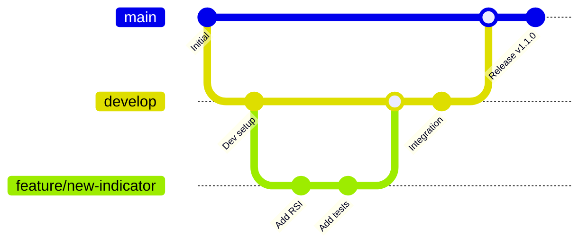
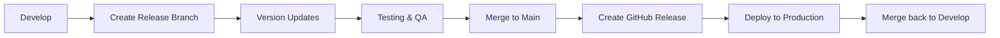

# Contributing to Roneira AI HIFI

<div align="center">


*We welcome contributions that improve correctness, performance, and developer experience.*

[**Quick Start**](#quick-start) • [**Development Setup**](#development-setup) • [**Code Style**](#code-style) • [**Testing**](#testing) • [**Pull Requests**](#pull-request-workflow)

</div>

## Table of Contents

<details>
<summary>Click to expand navigation</summary>

- [Quick Start](#quick-start)
- [Development Setup](#development-setup)
- [Branching Model](#branching-model)
- [Commit Guidelines](#commit-guidelines)
- [Code Style Guidelines](#code-style-guidelines)
- [Testing Requirements](#testing-requirements)
- [Pull Request Workflow](#pull-request-workflow)
- [Review Process](#review-process)
- [Release Process](#release-process)
- [Community Guidelines](#community-guidelines)
- [Getting Help](#getting-help)

</details>

## Quick Start

### First-Time Contributors

1. **Fork the repository** on GitHub
2. **Clone your fork** locally:
   ```bash
   git clone https://github.com/YOUR_USERNAME/Roneira-AI-HIFI.git
   cd Roneira-AI-HIFI
   ```
3. **Add upstream remote**:
   ```bash
   git remote add upstream https://github.com/aaron-seq/Roneira-AI-HIFI.git
   ```
4. **Set up development environment**:
   ```bash
   npm ci
   cp .env.example .env.local
   ```
   Follow [Development Setup](#development-setup) for Supabase and the ML service.
5. **Create a feature branch**:
   ```bash
   git checkout -b feature/your-feature-name
   ```
6. **Make your changes** and commit following our guidelines
7. **Push and create a Pull Request**

### Good First Issues

Look for issues labeled with:
- `good first issue` - Perfect for newcomers
- `help wanted` - Community contributions needed
- `documentation` - Improve docs and guides
- `bug` - Fix existing issues
- `enhancement` - Add new features

## Development Setup

### System Requirements

<table>
<tr>
<td width="50%">

**Required Software**
- Node.js >= 22.12.0 and npm >= 9.0.0 (see `package.json` engines)
- Python 3.11 — exactly, to match `ml/runtime.txt` and CI. Not "3.11 or newer": `numpy<2.1` has no 3.13 wheels, so a newer interpreter silently resolves a different numpy than the one tested (#140)
- Git >= 2.30

</td>
<td width="50%">

**Recommended Tools**
- VS Code with extensions:
  - TypeScript and JavaScript Language Features
  - Python Extension Pack
  - GitLens
  - Prettier - Code formatter

</td>
</tr>
</table>

### Environment Setup

<details>
<summary><strong>Setup overview</strong></summary>

```bash
# From the repository root
npm ci
cp .env.example .env.local
python3.11 -m venv .venv
source .venv/bin/activate
python -m pip install -r ml/requirements.txt
cp ml/.env.example ml/.env
```

Configure the files, choose a database path, run checks and start the services
as described below. There is no combined setup/start script in this repository.

</details>

<details>
<summary><strong>Manual Setup</strong></summary>

> **Where does my change go?** `src/` (Next.js app), `ml/` (FastAPI service) and
> `supabase/` (migrations) are the entire repository. See the Repository Layout
> table in the README and the canonical paths in `task.md`.

**1. Environment Configuration**
```bash
# Copy the environment template and fill in your values
cp .env.example .env.local
```

Supabase variables are required for auth and persistence. Market-data API keys
are optional — the app degrades gracefully without them.

**2. Install Dependencies**
```bash
# Web app (repo root)
npm ci

# ML service (requirements.txt is the single source of truth)
python3.11 -m venv .venv  # Windows: py -3.11 -m venv .venv
source .venv/bin/activate # Windows PowerShell: .venv\Scripts\Activate.ps1
python -m pip install -r ml/requirements.txt
cp ml/.env.example ml/.env
```

Set the same `ML_SERVICE_TOKEN` in `.env.local` and `ml/.env` (generate one with
`openssl rand -hex 32`). Keep `ML_BACKEND_URL=http://localhost:8000` server-side.
An unset ML token returns 503 on protected endpoints; mismatched tokens return
401. The ML service supplies predictions, the screener and Yahoo data fallbacks.

**3. Database Setup**

Schema lives in `supabase/migrations/`: apply 001 through 015 in filename order;
004 is absent. Migration 012 is required for atomic price-alert delivery; 013 adds private server-valued portfolio history and its ordered-save RPC; 014 restricts audit insertion to trusted server/database writers. Migration 015 permits narrowly scoped account-deletion FK cleanup while retaining immutable audit event fields. The [database guide](supabase/tests/README.md) includes SQL and real disposable GoTrue regressions. The audit endpoint verifies the session and derives its actor before using a server-only client. Pick one:

*Local stack (recommended for development, needs Docker and disk space for images):*

```bash
npx supabase start        # first run pulls the images; applies migrations + supabase/seed.sql
npx supabase status       # prints the API URL, anon key and service_role key
```

Copy the printed values into `.env.local`:

```bash
NEXT_PUBLIC_SUPABASE_URL=http://127.0.0.1:54321
NEXT_PUBLIC_SUPABASE_ANON_KEY=<anon key from supabase status>
SUPABASE_SERVICE_ROLE_KEY=<service_role key from supabase status>
```

The seed creates two **local-only test accounts** with a portfolio, transaction
history and watchlist. Their usernames and passwords are at the top of
[`supabase/seed.sql`](./supabase/seed.sql). Sign in on `/login` with the
username. `npx supabase db reset` rebuilds the database from scratch;
`npx supabase stop` shuts the stack down. Studio runs at http://127.0.0.1:54323.

*Hosted project:* link the intended project with `npx supabase link --project-ref
<project-ref>`, then apply pending migrations with `npx supabase db push`, or run
the SQL files in order in the dashboard's SQL editor. Verify the target before
making schema changes. Never run `seed.sql` there.

**4. Start Development Servers**
```bash
# Terminal 1: Next.js app — UI + API routes (http://localhost:3000)
npm run dev

# Terminal 2: ML service, optional (http://localhost:8000)
source .venv/bin/activate && npm run ml:dev
```

The second terminal starts at the repository root. For deployment, set
`CRON_SECRET` and use the schedules in `vercel.json` to evaluate in-app price
alerts; a local development server does not run those schedules automatically.

</details>

### Docker Development

Docker is used for one thing: the local Supabase stack above, which the
Supabase CLI manages. The app and the ML service themselves run directly
(the two-terminal setup above). The old `docker-compose.yml` composed only the
legacy services and had no service for `src/` or `ml/`, so it was deleted
rather than rewritten -- the deployment targets are Vercel and
Railway/Render, not containers.

**Windows: "The file cannot be accessed by the system" on Docker Desktop
start.** Docker Desktop can leave broken Unix-socket files behind
(`%LOCALAPPDATA%\Docker\run\*.sock`,
`%LOCALAPPDATA%\docker-secrets-engine\engine.sock`) that Windows then cannot
delete or rename, and the next start fails on them. Quit Docker Desktop,
rename those two folders (for example add `.old`), and start it again; it
recreates them. Do not use "Reset to factory defaults" for this -- it deletes
every image and volume.

## Branching Model

We follow a simplified Git Flow model with the following branch types:



### Branch Types

| Branch Type | Purpose | Naming Convention | Lifetime |
|-------------|---------|-------------------|----------|
| `main` | Production-ready code, protected | `main` | Permanent |
| `develop` | Integration branch for next release | `develop` | Permanent |
| `feature/` | New features and enhancements | `feature/issue-number-description` | Short-lived |
| `bugfix/` | Bug fixes for develop branch | `bugfix/issue-number-description` | Short-lived |
| `hotfix/` | Critical fixes for production | `hotfix/issue-number-description` | Short-lived |
| `release/` | Release preparation | `release/version-number` | Short-lived |

### Branch Naming Examples

```bash
# Good examples
feature/123-add-cryptocurrency-support
bugfix/456-fix-portfolio-calculation
hotfix/789-security-vulnerability-patch
release/2.1.0

# Bad examples
feature/crypto        # Too vague
my-new-feature       # No issue reference
FIX-BUG             # Wrong case, no description
```

## Commit Guidelines

### Conventional Commits

We follow the [Conventional Commits](https://www.conventionalcommits.org/) specification:

```
<type>[optional scope]: <description>

[optional body]

[optional footer(s)]
```

#### Commit Types

| Type | Description | Release Impact |
|------|-------------|----------------|
| `feat` | New feature | Minor version bump |
| `fix` | Bug fix | Patch version bump |
| `docs` | Documentation only | No version bump |
| `style` | Code style changes (formatting, etc.) | No version bump |
| `refactor` | Code refactoring | No version bump |
| `perf` | Performance improvements | Patch version bump |
| `test` | Adding or updating tests | No version bump |
| `build` | Build system or dependencies | No version bump |
| `ci` | CI/CD changes | No version bump |
| `chore` | Maintenance tasks | No version bump |
| `revert` | Reverting previous commit | Depends on reverted commit |

#### Scopes

Use these scopes to indicate which part of the codebase is affected:

- `web` - Next.js/React/TypeScript changes in `src/`
- `ml` - Python ML service changes
- `api` - API-related changes
- `db` - Database schema or query changes
- `auth` - Authentication/authorization changes
- `ui` - UI component changes
- `docs` - Documentation changes
- `deps` - Dependency updates

#### Examples

```bash
# Good commit messages
feat(ml): add support for cryptocurrency price prediction
fix(api): resolve race condition in portfolio calculation
perf(db): optimize query performance for large datasets
docs(readme): update installation instructions for Windows
test(frontend): add unit tests for prediction components
refactor(backend): extract common validation logic

# Commit with body and footer
feat(auth): implement multi-factor authentication

Add TOTP-based 2FA using authenticator apps.
Includes QR code generation and backup codes.

Closes #123
Breaking-change: Auth API now requires 2FA for admin users
```

### Commit Message Rules

- **Use imperative mood** ("add" not "added" or "adds")
- **Capitalize first letter** of description
- **No period** at end of description
- **Limit description to 50 characters**
- **Wrap body at 72 characters**
- **Reference issues** using "Closes #123" or "Refs #456"
- **Indicate breaking changes** with "BREAKING CHANGE:" in footer

### Pre-commit Hooks

We use pre-commit hooks to ensure code quality:

```bash
# Install pre-commit hooks
npm run prepare

# Manually run pre-commit checks
npm run pre-commit

# Skip hooks for emergency commits (not recommended)
git commit --no-verify -m "emergency fix"
```

## Code Style Guidelines

### TypeScript (Frontend/Backend)

<details>
<summary><strong>General Principles</strong></summary>

- **Strict TypeScript**: Enable `strict` mode and use explicit types
- **Descriptive Naming**: Use domain-relevant variable names
- **Pure Functions**: Prefer pure functions, isolate side effects
- **Error Handling**: Return typed error objects with actionable context
- **Documentation**: Use JSDoc for complex functions and public APIs

</details>

<details>
<summary><strong>Naming Conventions</strong></summary>

```typescript
// Variables and functions: camelCase
const priceVelocity = calculatePriceVelocity(data);
const portfolioSnapshot = getPortfolioSnapshot();

// Classes: PascalCase
class TechnicalIndicator {
  calculateRSI(prices: number[]): number {
    // Implementation
  }
}

// Constants: SCREAMING_SNAKE_CASE
const MAX_PORTFOLIO_SIZE = 100;
const API_ENDPOINTS = {
  PREDICTIONS: '/api/v1/predictions',
  PORTFOLIO: '/api/v1/portfolio'
} as const;

// Interfaces and Types: PascalCase
interface PredictionRequest {
  ticker: string;
  days: number;
  includeConfidence: boolean;
}

type ModelType = 'randomforest' | 'xgboost' | 'lstm';
```

</details>

<details>
<summary><strong>File Structure</strong></summary>

```typescript
// File organization example
src/
├── components/          # React components
│   ├── ui/             # Reusable UI components
│   ├── prediction/     # Prediction-specific components
│   └── portfolio/      # Portfolio-specific components
├── hooks/              # Custom React hooks
├── services/           # API services and utilities
├── types/              # TypeScript type definitions
├── utils/              # Utility functions
└── constants/          # Application constants

// Import order
import React from 'react';                    // External libraries first
import { Button } from '@/components/ui';      // Internal imports with aliases
import { PredictionService } from '../services'; // Relative imports last
```

</details>

### Python (ML Service)

<details>
<summary><strong>Code Style</strong></summary>

- **PEP 8 Compliance**: Follow Python style guide strictly
- **Type Hints**: Use type hints for all function signatures
- **Docstrings**: Use Google-style docstrings
- **Error Handling**: Implement comprehensive error handling
- **Vectorization**: Optimize for NumPy/Pandas operations

</details>

<details>
<summary><strong>Example Code</strong></summary>

```python
from typing import List, Tuple, Optional
import numpy as np
import pandas as pd
from dataclasses import dataclass

@dataclass
class PredictionResult:
    """Container for ML prediction results.
    
    Attributes:
        price: Predicted price value
        confidence: Confidence interval (lower, upper)
        probability: Prediction probability score
        timestamp: Prediction timestamp
    """
    price: float
    confidence: Tuple[float, float]
    probability: float
    timestamp: pd.Timestamp

class TechnicalIndicators:
    """Technical analysis indicators calculator.
    
    This class provides vectorized implementations of common
    technical indicators used in financial analysis.
    """
    
    @staticmethod    
    def calculate_rsi(
        prices: pd.Series, 
        period: int = 14,
        *, 
        fill_na: bool = True
    ) -> pd.Series:
        """Calculate Relative Strength Index (RSI).
        
        Args:
            prices: Series of price values
            period: RSI calculation period (default: 14)
            fill_na: Whether to fill NaN values (default: True)
            
        Returns:
            Series containing RSI values (0-100)
            
        Raises:
            ValueError: If period is less than 1 or prices is empty
        """
        if period < 1:
            raise ValueError("Period must be greater than 0")
        
        if prices.empty:
            raise ValueError("Prices series cannot be empty")
            
        # Vectorized RSI calculation
        delta = prices.diff()
        gain = delta.where(delta > 0, 0)
        loss = -delta.where(delta < 0, 0)
        
        avg_gain = gain.rolling(window=period).mean()
        avg_loss = loss.rolling(window=period).mean()
        
        rs = avg_gain / avg_loss
        rsi = 100 - (100 / (1 + rs))
        
        if fill_na:
            rsi = rsi.fillna(50)  # Neutral RSI for initial values
            
        return rsi
```

</details>

### Configuration Files

<details>
<summary><strong>ESLint Configuration</strong></summary>

```json
{
  "extends": [
    "@typescript-eslint/recommended",
    "prettier"
  ],
  "rules": {
    "@typescript-eslint/no-unused-vars": "error",
    "@typescript-eslint/explicit-function-return-type": "warn",
    "prefer-const": "error",
    "no-var": "error"
  }
}
```

</details>

<details>
<summary><strong>Prettier Configuration</strong></summary>

```json
{
  "semi": true,
  "trailingComma": "es5",
  "singleQuote": true,
  "printWidth": 80,
  "tabWidth": 2,
  "useTabs": false
}
```

</details>

## Repository Map & Canonical Entrypoints

Before changing a service, know which file actually runs. The repo retains
several historical implementations; only the canonical surfaces below are
built, tested, and deployed.

### Canonical — contribute here

| Area | Entrypoint | Run with | Notes |
|------|-----------|----------|-------|
| **Web app + API** | `src/` (Next.js) | `npm run dev` | UI *and* the API route handlers under `src/app/api/`. Deploys to Vercel via `vercel.json`. |
| **ML service** | `ml/app/main.py` (FastAPI) | `npm run ml:dev` | Six pluggable models + offline LSTM/GAN artifacts. See `ml/MODELS.md`. |
| **Database** | `supabase/migrations/` | Supabase CLI | Schema, RLS policies, audit triggers. |

### Removed legacy trees

`frontend/` (Vite client), `backend/` (Express gateway), `ml-service/`
(Flask/FastAPI service), `realtime/` (Socket.IO) and `infrastructure/`
(TimescaleDB init scripts) were earlier implementations. They were never built,
tested, or deployed, and have been deleted — git history preserves them. If an
older issue points at a file in one of those trees, the behaviour either lives
under `src/` or `ml/` now, or no longer exists.

**Dependency rule for the ML service**: `ml/requirements.txt` is the single
source of truth for the canonical service.

## Contributing a Machine Learning Model

Read [`ml/MODELS.md`](ml/MODELS.md) first — it reviews the existing six models
(Random Forest, LSTM, GAN, Technical Analysis, PVD Momentum, Ensemble) and the
decision guide for when each is appropriate. A new model should fill a gap that
table doesn't already cover.

### Checklist

- [ ] **Location**: add the module under `ml/app/models/<your_model>.py`.
- [ ] **Interface**: implement `predict(df, horizon)` (or `analyze(...)` for
      rule-based engines) returning the standard prediction dict
      (`predicted_price`, `confidence`, `indicators`, …) and an `is_ready()`
      method so the health endpoint can report degraded state.
- [ ] **Keep training offline**: heavy training belongs in `ml/train_models.py`,
      producing a versioned artifact loaded at startup — **never** train inside a
      request handler on the hot path (the LSTM/GAN models are the reference
      pattern; Random Forest is the accepted exception and is documented as
      retraining per-request).
- [ ] **Enforced artifact contract**: record the backend, feature/window schema,
      session horizon and purged validation cutoffs. Reject incompatible bundles;
      never pad/truncate features or reuse a fixed-horizon target for another horizon.
- [ ] **Graceful fallback**: expose `fallback` and a stable `fallback_reason`.
      A missing/incompatible artifact returns a disclosed no-change reference,
      excluded from blends and forecast history. TensorFlow training is disabled.
- [ ] **Register it**: wire the model into the `model_type` switch and the
      root endpoint's `models` list in `ml/app/main.py`. If it should participate in the
      Ensemble, add it there with a justified weight.
- [ ] **Validate honestly**: use a chronological/walk-forward scheme and purge
      labels by their actual resolution timestamps. Keep shared-date instruments
      in one split; report signed skill, no-change baseline and forecast coverage.
- [ ] **Numerical safety**: handle NaNs, empty/short histories, and
      division-by-zero explicitly (see the PDM engine's `np.where` volume-
      sensitivity handling for the expected standard).
- [ ] **Document it**: add a row to the comparison table in `ml/MODELS.md` with
      an honest strengths **and** weaknesses entry, plus a short review section.
- [ ] **Test it**: add `pytest` cases covering the happy path, an
      insufficient-data input, and the fallback path.

### Anti-patterns we reject

- Hard-coded results (e.g. a backtest that returns a fixed number instead of
  computing it — this was a real bug fixed in the PDM engine, issue #7).
- Arbitrary "demo" limits left in production paths (`for x in items[:10]  # remove in production`).
- Fetching the same market data more than once per request.
- Binary/all-or-nothing confidence scores where a continuous, magnitude-aware
  score is feasible.

## Fixing a Reported Issue

Most contributions here start from a GitHub issue. The expected workflow:

1. **Claim it** — comment on the issue so work isn't duplicated.
2. **Branch** — `git checkout -b bugfix/<issue-number>-short-description`
   (or `feature/…`). Reference the issue number in the branch name.
3. **Reproduce first** — add or identify a failing test that captures the bug
   before fixing it, where practical.
4. **Fix the root cause**, not the symptom. If the issue lists a "Recommended
   Fix", treat it as a starting point, not gospel — implement the approach that
   best fits the codebase.
5. **Verify**: run the relevant checks (see below). For web changes,
   `npm run lint && npm run type-check && npm run test:web && npm run build`;
   for ML changes, `npm run test:ml`.
6. **Reference the issue** in your commit and PR body: `Closes #<number>`.
7. **Keep the PR scoped** to the issue — unrelated cleanup belongs in its own PR.

## Testing Requirements

### Test Coverage Goals

| Component | Unit Tests | Integration Tests | E2E Tests |
|-----------|------------|-------------------|----------|
| Web (`src/`) | >85% | >70% | Critical paths |
| ML service (`ml/`) | >85% | >75% | Inference and validation behavior |

These are goals, not enforced coverage thresholds or promises of forecast
accuracy. CI currently runs the commands below; hosted database/provider checks
need their own configured environment.

### Testing Commands

Run these from the repository root with the Python 3.11 environment activated.
They cover the web/ML CI checks; inspect the actual PR checks before merging.

```bash
# Web (Next.js) — src/
npm run test:web          # Unit tests with Vitest
npm run test:watch        # Watch mode while developing
npm run lint              # ESLint
npm run type-check        # tsc --noEmit
npm run build             # Production build

# ML service — ml/
npm run test:ml           # pytest, from the repo root
# ...or directly:
cd ml
python -m pytest tests -q          # All tests
python -m pytest tests --cov=app   # With coverage
python -m pytest -k "rsi"          # Specific test pattern
```

### Test Structure

Use the existing executable suites as examples rather than the deleted Express,
Flask or Vite implementations:

- [`src/lib/utils.test.ts`](src/lib/utils.test.ts): currency formatting and display helpers.
- [`src/lib/server/cache.test.ts`](src/lib/server/cache.test.ts): cache expiry,
  concurrent misses and invalidation.
- [`src/app/api/cron/alerts/route.test.ts`](src/app/api/cron/alerts/route.test.ts):
  Next.js route authentication, current-session quotes and retry behavior.
- [`ml/tests/test_app_entrypoint.py`](ml/tests/test_app_entrypoint.py): the real
  FastAPI entrypoint, shared-token boundary and market-data batches.
- [`ml/tests/test_models.py`](ml/tests/test_models.py): deterministic model fixtures.
- [`supabase/tests/README.md`](supabase/tests/README.md): disposable PostgreSQL
  migration and atomic alert-delivery regressions, not a hosted Auth HTTP test.

Use `// @vitest-environment jsdom` only in tests that need a DOM; server tests
keep the default Node environment. Mock metered data providers and auth fixtures
for deterministic checks. Never run destructive database fixtures against a
hosted project or use production credentials in tests.

## Pull Request Workflow

### Before Creating a PR

**Pre-flight Checklist**
- [ ] Code follows style guidelines and passes linting
- [ ] All tests pass locally
- [ ] New code has appropriate test coverage
- [ ] Documentation updated (README, API docs, comments)
- [ ] Commit messages follow conventional commit format
- [ ] No merge conflicts with target branch
- [ ] Large changes are broken into smaller, focused PRs

### PR Creation

**PR Title Format**
```
<type>[scope]: <description>

# Examples:
feat(ml): add cryptocurrency price prediction support
fix(api): resolve race condition in portfolio calculations
docs(readme): update Docker setup instructions
```

**PR Description Template**
```markdown
## Summary
Brief description of what this PR does and why.

## Changes
- List of specific changes made
- Use bullet points for clarity
- Include any breaking changes

## Testing
- [ ] Unit tests added/updated
- [ ] Integration tests pass
- [ ] Manual testing completed
- [ ] Performance impact assessed

## Screenshots/Demo
(If applicable, include screenshots or demo links)

## Related Issues
Closes #123
Refs #456

## Deployment Notes
(Any special deployment considerations)

## Breaking Changes
(List any breaking changes and migration steps)
```

### PR Labels

| Label | Description |
|-------|-------------|
| `bug` | Bug fixes |
| `enhancement` | New features |
| `documentation` | Documentation updates |
| `dependencies` | Dependency updates |
| `breaking change` | Introduces breaking changes |
| `needs review` | Ready for review |
| `work in progress` | Not ready for review |
| `good first issue` | Good for new contributors |

## Review Process

### Code Review Guidelines

**For Reviewers**
- Focus on code correctness, security, and maintainability
- Provide constructive feedback with explanations
- Suggest improvements rather than just pointing out problems
- Approve PRs that meet standards, even if not perfect
- Use collaborative language ("we could" vs "you should")

**For Authors**
- Respond to all review comments
- Make requested changes promptly
- Ask questions if feedback is unclear
- Request re-review after making changes
- Be open to feedback and alternative approaches

### Review Requirements

| Change Type | Required Reviewers | Additional Requirements |
|-------------|-------------------|------------------------|
| Bug fixes | 1 maintainer | Tests must pass |
| New features | 2 maintainers | Design discussion |
| Breaking changes | All maintainers | Migration guide |
| Security fixes | Security team | Security review |
| Dependencies | 1 maintainer | Security scan |

### Automated Checks

All PRs must pass these automated checks:

```yaml
# GitHub Actions checks
✓ Lint (ESLint, Prettier, Black)
✓ Type Check (TypeScript, mypy)
✓ Unit Tests (>85% coverage)
✓ Integration Tests
✓ Security Scan (Snyk, CodeQL)
✓ Performance Tests
✓ Build Verification
```

## Release Process

### Semantic Versioning

We follow [Semantic Versioning 2.0.0](https://semver.org/):

- **MAJOR** (X.0.0): Breaking changes
- **MINOR** (1.X.0): New features, backward compatible
- **PATCH** (1.1.X): Bug fixes, backward compatible

### Release Workflow



**Release Steps**
1. Create release branch: `git checkout -b release/2.1.0`
2. Update version numbers in package.json files
3. Update CHANGELOG.md with release notes
4. Run full test suite and QA testing
5. Create PR to main branch
6. After merge, create GitHub release with tags
7. Deploy to production environments
8. Merge release branch back to develop

### Changelog Format

```markdown
# Changelog

## [2.1.0] - 2024-01-15

### Added
- Cryptocurrency price prediction support
- Real-time portfolio notifications
- Advanced technical analysis indicators

### Changed
- Improved ML model accuracy by 15%
- Updated UI design for better accessibility
- Enhanced API rate limiting

### Fixed
- Portfolio calculation race condition
- Memory leak in ML service
- Chart rendering on mobile devices

### Security
- Updated dependencies with security patches
- Enhanced input validation

### Breaking Changes
- API endpoint `/api/predictions` renamed to `/api/v1/predictions`
- Database schema changes require migration
```

## Community Guidelines

### Communication Channels

- **GitHub Issues**: Bug reports, feature requests
- **GitHub Discussions**: General questions, ideas, showcase
- **Pull Requests**: Code contributions and reviews
- **Email**: aaronsequeira12@gmail.com for private matters

### Recognition

We recognize contributions through:

- **Contributors List**: Maintained in README.md
- **Release Notes**: Contributors credited in each release
- **GitHub Stars**: Star contributors with significant contributions
- **Blog Posts**: Featuring community contributions

### Contribution Types

We value all types of contributions:

- **Code**: New features, bug fixes, performance improvements
- **Documentation**: Guides, API docs, examples, translations
- **Testing**: Writing tests, reporting bugs, testing releases
- **Design**: UI/UX improvements, accessibility enhancements
- **Community**: Helping others, mentoring, organizing events

## Getting Help

### Resources

- [**Project Documentation**](https://docs.roneira.com)
- [**API Reference**](https://api.roneira.com/docs)
- [**GitHub Discussions**](https://github.com/aaron-seq/Roneira-AI-HIFI/discussions)
- [**Issue Tracker**](https://github.com/aaron-seq/Roneira-AI-HIFI/issues)

### Support Channels

**For Technical Questions**
- GitHub Discussions (preferred)
- Stack Overflow with `roneira-ai` tag
- Project documentation and FAQ

**For Bug Reports**
- GitHub Issues with bug report template
- Include reproduction steps and environment details
- Search existing issues before creating new ones

**For Feature Requests**
- GitHub Discussions for initial discussion
- GitHub Issues for formal feature requests
- Include use cases and mockups if applicable

### Mentorship Program

New contributors can request mentorship:

1. Comment on a "good first issue" expressing interest
2. Tag a maintainer for guidance
3. Join our contributor onboarding program
4. Participate in regular office hours

---

<div align="center">

**Thank you for contributing to Roneira AI HIFI!**

Your contributions help make financial intelligence accessible to everyone.

[**Start Contributing**](https://github.com/aaron-seq/Roneira-AI-HIFI/issues?q=is%3Aissue+is%3Aopen+label%3A%22good+first+issue%22) • [**Join Discussions**](https://github.com/aaron-seq/Roneira-AI-HIFI/discussions) • [**View Roadmap**](https://github.com/aaron-seq/Roneira-AI-HIFI/projects)

</div>
