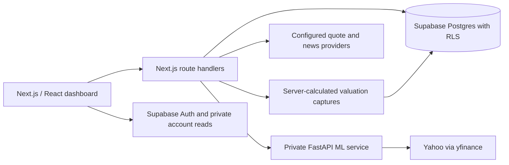

# Roneira AI HIFI

An open-source workspace for understanding a personal stock portfolio and researching stock forecasts across different trading-session horizons.

For portfolio owners, the goal is to make three questions clear: **What is my portfolio worth? Which holdings are gaining or losing? How has its recorded value changed?** Analysts can inspect model estimates, underlying methods and measured limitations alongside market data.

**Free to use and contribute to. No subscription or license-fee flow is implemented.** The software uses the [MIT license](LICENSE). Market-data permissions and private account data are separate from the software license.

[Architecture](ARCHITECTURE.md) · [Model guide](ml/MODELS.md) · [Contributing](CONTRIBUTING.md) · [Deployment](DEPLOYMENT.md) · [Issues](https://github.com/aaron-seq/Roneira-AI-HIFI/issues) · [Product plan and PRDs](docs/product/README.md) · [Data project](data/README.md)

## What you can do

| Workflow | Available behavior | What the figures mean |
|---|---|---|
| Maintain holdings | Add, edit and remove Indian and US stock positions | Tracking only; no broker orders are placed |
| Understand current value | Per-position and total marked value, cost basis, unrealized profit/loss, allocation and concentration | Totals cover the priced, convertible book; missing quotes, invalid inputs and unavailable FX are disclosed |
| Follow portfolio history | Save server-calculated daily value/cost/P&L captures and inspect a history chart and exact values | Actual recorded observations, starting with the first capture; changes in value are not cash-flow-adjusted investment returns |
| Understand markets | Regional-index movement, stock movers and market/portfolio insight stories | A configured sample, with provider and exchange-session provenance; overlapping indices do not establish whole-market breadth |
| Research a stock | Compare a selected method and session horizon, features, compatible members and unavailable results | Forecasts are research estimates, not probabilities or assured trading outcomes |
| Monitor and review | Watchlists, in-app price alerts, saved prediction records and account audit events | Alerts require the configured cron workflow; quote freshness depends on the source |

### Portfolio history

[Calculation, API, validation and screenshots](docs/portfolio-history.md).

The server reads your holdings, fetches quotes and conversion rates, and calculates each capture. Clients cannot submit portfolio totals, choose another account or fabricate past dates. History is private to the signed-in account.

- Each currency has its own series and one capture per **UTC calendar day**. Saving again replaces that day's observation.
- Opening the portfolio attempts a capture when today's entry is missing; you can also refresh it explicitly. There is no unattended daily capture schedule: days without observations remain missing.
- Current cost basis and market value are recorded together. Unknown prices/FX remain explicit; an unpriced book is not a portfolio worth zero.
- Capture time describes when the portfolio was recorded. Source quote timestamps and exchange session dates can be earlier.
- Unrealized P&L excludes realized gains, cash, deposits/withdrawals, fees, taxes, dividends and historical FX effects. Editing holdings or cost basis can change the series without an investment gain.

The current app does not maintain a complete transaction/cash-flow ledger or calculate time-weighted/money-weighted returns. It does not reconstruct historical holdings from today's portfolio. Transaction-aware accounting and attribution remain tracked in [#147](https://github.com/aaron-seq/Roneira-AI-HIFI/issues/147).

## How the models work

The six API identifiers are compatibility names. The actual algorithms matter more than their labels.

| UI method / API identifier | Implementation | Training and horizon | Main limit |
|---|---|---|---|
| Random forest / `RANDOM_FOREST` | Bagged decision-tree regression on engineered return, volume and technical features | Fits the current ticker prefix for the requested session count; purged chronological validation | Per-request fitting has latency; young listings and long horizons may lack resolved labels |
| Sequence artifact / `LSTM` | XGBoost regressor over 60 ordered feature rows, flattened into one vector | Offline; the shipped bundle is trained for **30 sessions** | This is **not a recurrent LSTM network**; another horizon returns a disclosed unavailable reference |
| Price/range artifact / `GAN` | XGBoost regressor over 30 rows of return/range/volume features | Offline; the shipped bundle is trained for **30 sessions** | This is **not a generative adversarial network**, scenario simulator or probability distribution |
| Technical rules / `TECHNICAL` | Indicator votes including RSI, MACD, trend, volatility and volume context | No fitted model | Votes and projected prices are heuristics |
| Momentum rules / `PVD_MOMENTUM` | Price/volume momentum and derivative-style rules | No fitted model | No validated execution, stop-loss or position-sizing strategy |
| Equal-weight blend / `ENSEMBLE` | Available Random Forest, Technical, PVD and sequence-artifact estimates | Compatible members receive equal, renormalized weights | Fallback/unsupported members are excluded; agreement does not add confidence or establish accuracy |

Both sequence slots currently use gradient-boosted point regressors. TensorFlow training is disabled until its causal preprocessing and validation pipeline is reviewed. `GAN` is not an ensemble member. Only trusted, reviewed model artifacts should be loaded; serialized Python model files can execute code when loaded.

### Short and longer horizons

The API accepts legacy aliases `tomorrow`, `1week`, `1month`, `3month`, `6month`, `1year` and `1year_plus`. They mean **1, 7, 30, 90, 180, 365 and 400 observed trading sessions**, respectively. They are not exchange-calendar conversions: 365 sessions is longer than one calendar year.

Select each horizon separately and check the actual method, data session, trained horizon and fallback state. The bundled sequence artifacts support only 30 sessions; a research model trained for another horizon is not automatically deployed. The legacy persisted calendar `target_date` remains tracked in [#157](https://github.com/aaron-seq/Roneira-AI-HIFI/issues/157) and must not be used as a verified exchange-session outcome date.

### What “accuracy” means here

A model score on the results screen is a **heuristic**, not the probability that a stock will rise or that a trade will be profitable. There is no supported claim of 90% accuracy.

The shipped 30-session artifacts' recorded held-out assessment is:

| Artifact slot | Return MAE | No-change return MAE | Signed skill versus no change |
|---|---:|---:|---:|
| Sequence (`LSTM`) | 0.06968 | 0.06257 | −0.114 |
| Price/range (`GAN`) | 0.06847 | 0.06263 | −0.093 |

Returns are fractions: 0.06968 means roughly 6.97 percentage points of absolute return error. Skill is `1 − model_MAE / baseline_MAE`; negative values mean the model did worse than predicting no change. These figures describe the metadata's assessment period, not future performance or a trading strategy. Source histories extend beyond the fitted training-label cutoff; see the artifact metadata for both training and validation dates.

The real-market research workflow trains and evaluates separate horizons on frozen provider histories, with exact label-resolution purging and chronological test periods. It reports errors, direction counts and base rates, unavailable coverage, folds and data hashes. Historical replay on selected surviving stocks is not a point-in-time or prospective investment record. Research results do not overwrite a deployed artifact automatically.

### Measured real-market study

The [2026-10-19 study](ml/research/results-2026-10-19.md) used ten years of actual adjusted daily histories for four Indian and two US stocks: 24 sequence fits and 236 Random Forest forecast origins. Candidates and parameters were frozen before scoring. The table describes the **refitted research ensemble**, not the shipped 30-session artifact or net trading performance.

| Horizon (sessions) | Scored origins | Ensemble MAE / no-change MAE (percentage points) | Pooled signed skill | Direction hits / always-up hits | Final-fold skill (origins) |
|---|---:|---:|---:|---:|---:|
| 7 | 72 | 3.04 / 2.99 | −0.016 | 34/72 / 37/72 | −0.038 (24) |
| 30 | 72 | 7.29 / 7.06 | −0.034 | 39/72 / 39/72 | −0.086 (24) |
| 90 | 62 | 11.39 / 11.48 | +0.008 | 31/62 / 32/62 | +0.141 (24) |
| 180 | 30 | 15.14 / 16.42 | +0.078 | 21/30 / 18/30 | −0.109 (12) |

The 180-session pooled gain reversed in its final period. Both sequence slots underperformed no change at every studied horizon, so **no candidate was promoted**. The small, correlated, selected-stock sample is not an unseen-instrument or prospective test. Reported ensemble recombinations omit the combiner's final cent rounding. Coverage, per-model baselines, training-label cutoffs, hashes and the one unavailable Technical projection are disclosed in the [full report](ml/research/results-2026-10-19.md) and [aggregate JSON](ml/research/results-2026-10-19.json).

See [the model guide](ml/MODELS.md), [the frozen real-market protocol](ml/research/README.md), and [the earlier fixed-data diagnostic](docs/ml-validation-2026-10-11.md) for contracts, baseline definitions and known limits.

## Free, open source and data rights

The initial product has no payment integration, subscription enforcement or license-fee gate. Contributors can inspect and improve the code, schemas, tests, training protocol and synthetic fixtures under MIT. Your portfolio, account and valuation history remain private.

Open-source code does **not** make third-party quotes, news, raw training histories or derived artifacts freely redistributable. API access and a free developer key do not by themselves grant public-display or commercial rights. Raw provider downloads stay in ignored local caches. Publish datasets or artifacts only when their applicable rights allow it.

Relevant provider guidance includes:

- [yfinance's maintainer notice](https://github.com/ranaroussi/yfinance#readme): research/educational tooling; the Yahoo finance API is intended for personal use.
- [Finnhub terms](https://finnhub.io/terms-of-service): data/derived-result sharing and commercial use require the applicable permission.
- [Alpha Vantage terms](https://www.alphavantage.co/terms_of_service/): default access has personal/noncommercial restrictions.
- [NewsAPI terms](https://newsapi.org/terms): the Developer plan is for development/testing, rather than staging or production.
- Twelve Data and exchange-specific rights depend on the selected contract; confirm display, redistribution and commercial use before hosting a public feed.

A future optional paid hosted service would need licensed data, reproducible positive results on genuinely unseen/prospective data, clear metric definitions, adequate coverage, and reliable operations. A single “90%” number would not justify charging: direction hit rate, BUY precision, price tolerance and interval coverage measure different things. Any claimed trading results would additionally need execution costs, liquidity, risk and drawdown analysis. No such paid launch or performance guarantee is being announced.

## Product and data project

The [product pack](docs/product/README.md) contains the vision, four PRDs and an evidence-gated [delivery plan](docs/product/delivery-plan.md): portfolio accounting, analyst research, market-data governance and future hosting. It includes personas, non-goals, acceptance criteria, priorities, dependencies, metrics, risks and rollout/rollback requirements. Planned work is explicitly separated from implemented behavior.

The [data project](data/README.md) reuses the frozen research pipeline. It provides a versioned dataset registry, public lineage/hash metadata, synthetic fixtures and a standard-library validator. Actual provider CSVs stay in ignored local caches. Validate fixture and registry changes before research; dataset hashes prove byte identity, not data rights or forecasting value.

[Delivery tracker #189](https://github.com/aaron-seq/Roneira-AI-HIFI/issues/189) and [repository milestones](https://github.com/aaron-seq/Roneira-AI-HIFI/milestones) track delivery. Pick a ready issue with its linked PRD, state the acceptance criteria and evidence, and link the review PR. No roadmap date, usability metric or future fee is presented as an achieved result.

## Architecture & technology stack



- **Web:** Next.js 16, React 19, TypeScript, TanStack Query, Zustand and Recharts.
- **ML:** Python 3.11, FastAPI, scikit-learn and XGBoost.
- **Persistence:** Supabase Auth/PostgreSQL with row-level security; server-calculated snapshot writes use a server-only service credential after authentication.
- **Runtime:** Vercel for the web app; Railway/Render-compatible ML deployment. Cached provider data and optional Upstash-backed rate limits have environment-dependent limits.

### Repository layout

| Path | Purpose |
|---|---|
| `src/app/` | Dashboard routes and Next.js API handlers |
| `src/components/` | UI, accessible controls, analysis and portfolio views |
| `src/lib/` | Account hooks, market normalization, financial calculations and server helpers |
| `ml/app/` | Model inference, contracts and data endpoints |
| `ml/train_models.py`, `ml/backtest.py` | Offline fitting and historical walk-forward evaluation |
| `ml/artifacts/generated/` | Reviewed shipped model bundles and metadata |
| `supabase/migrations/`, `supabase/tests/` | Database schema, RLS and SQL regressions |
| `data/` | Dataset registry, contracts, synthetic fixtures and data validation |
| `docs/` | Product PRDs, delivery plan, design decisions, validation reports and captured screens |

## Getting started

Use Node **22.12 or newer**, npm and **Python 3.11**. Python 3.11 matches the tested ML runtime. Docker is needed for local Supabase; a deliberately configured hosted development project is an alternative.

```bash
npm ci
python3.11 -m venv .venv
source .venv/bin/activate
python -m pip install -r ml/requirements.txt
cp .env.example .env.local
cp ml/.env.example ml/.env
```

Start a local database:

```bash
npx supabase start
npx supabase status
```

Use its local URL/keys in `.env.local`. The committed seed contains synthetic local test accounts and holdings; see [supabase/seed.sql](supabase/seed.sql). Apply all migrations in filename order, including `013_portfolio_valuation_snapshots.sql`; `004` is absent. Never seed a hosted project with local fixture accounts. Review [CONTRIBUTING.md](CONTRIBUTING.md) for the hosted-development alternative.

### Configuration

| Variables | Use |
|---|---|
| `NEXT_PUBLIC_SUPABASE_URL`, `NEXT_PUBLIC_SUPABASE_ANON_KEY` | Browser/server access to the selected Supabase project |
| `SUPABASE_SERVICE_ROLE_KEY` | Server-only operations including trusted snapshot writes; never expose it to the browser |
| `NEXT_PUBLIC_APP_URL` | Application URL |
| `ML_BACKEND_URL`, `ML_SERVICE_TOKEN` | Server-to-server ML URL and shared token |
| `ML_MODEL_DIR` | Model artifact directory, relative to `ml/` unless absolute |
| `TWELVE_DATA_API_KEY`, `ALPHA_VANTAGE_API_KEY`, `FINNHUB_API_KEY`, `NEWS_API_KEY` | Optional provider access, subject to plan permissions |
| `UPSTASH_REDIS_URL`, `UPSTASH_REDIS_TOKEN` | Shared rate limits; the fallback is per process |
| `CRON_SECRET` | Authenticated scheduled price-alert evaluation |
| `ADMIN_*` | Explicit admin maintenance, not ordinary startup |

Generate your own `ML_SERVICE_TOKEN` and configure the **same value** in the web and ML environments. The ML service returns 503 on protected endpoints when unset and 401 for a mismatched token. Provider keys can remain absent for supported personal-research fallback workflows. `HUGGING_FACE_API_KEY` is not currently used by the forecasting models. Keep secrets out of Git; use secure deployment/environment settings.

Run the two services from the repository root:

```bash
# Terminal 1
npm run dev

# Terminal 2
source .venv/bin/activate
npm run ml:dev
```

The ML health endpoint is `/health`; its OpenAPI interface is `/docs` on the running ML service. A healthy process alone does not establish provider access, fresh quotes, valid hosted auth or model accuracy.

## Training and testing

Offline fitting is separate from application startup. Train candidate artifacts into an isolated output directory so experimenting with another horizon cannot overwrite the shipped 30-session bundle:

```bash
cd ml
ML_MODEL_DIR=.cache/candidates/h30 ../.venv/bin/python train_models.py \
  --backend gradient-boost --models all --period 10y --horizon 30
```

A successful fit is not a deployment approval. Inspect held-out errors, baseline skill, coverage and data provenance, then evaluate the served method on untouched periods. Keep raw downloads out of commits and retain only rights-compatible code/configs/results. See [ml/MODELS.md](ml/MODELS.md) for reproducible evaluation commands and the current research protocol.

Run validation from the repository root:

```bash
npm run lint
npm run type-check
npm run test:web
npm run build
source .venv/bin/activate
OMP_NUM_THREADS=2 OPENBLAS_NUM_THREADS=2 MKL_NUM_THREADS=2 python -m pytest ml/tests -q
npm run test:data
```

SQL regression instructions are in [supabase/tests/README.md](supabase/tests/README.md). Model tests use controlled fixtures; real-provider research runs and disposable Auth/RLS/browser integration are separate checks. The native Git pre-commit hook runs web checks and, when ML files are staged, the ML suite; activate `.venv` before committing.

## Contributing and known limits

Start with [CONTRIBUTING.md](CONTRIBUTING.md) and the [issue tracker](https://github.com/aaron-seq/Roneira-AI-HIFI/issues). Changes should include focused financial/security regressions and reproducible evidence. Never submit credentials, private portfolios or provider data without redistribution rights. Do not improve reported accuracy by excluding hard outcomes, shuffling temporal splits or tuning on the final test period.

Current follow-ups include transaction-aware accounting/attribution [#147](https://github.com/aaron-seq/Roneira-AI-HIFI/issues/147), forecast date contracts [#157](https://github.com/aaron-seq/Roneira-AI-HIFI/issues/157), Auth audit-reference deletion [#174](https://github.com/aaron-seq/Roneira-AI-HIFI/issues/174), same-null profile/query recovery [#176](https://github.com/aaron-seq/Roneira-AI-HIFI/issues/176), and dependency/deprecation follow-up [#149](https://github.com/aaron-seq/Roneira-AI-HIFI/issues/149). Risk budgeting, calibrated probabilities, reliable prediction intervals and automated portfolio management are not implemented.

[Architecture](ARCHITECTURE.md), [deployment guidance](DEPLOYMENT.md), [model behavior](ml/MODELS.md), [data-story calculations](docs/data-stories-2026-10-13.md) and [ADRs](docs/adr) provide deeper context. Published screenshots and research numbers describe their recorded dates, rather than a live service guarantee.
