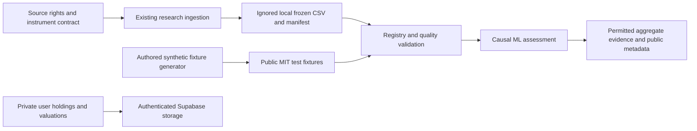

# Roneira data project

This directory makes the research inputs discoverable and testable without
publishing provider bars or customer portfolios. It contains a versioned
[source/dataset registry](registry.json), a standard-library quality validator
and authored synthetic fixtures. Market ingestion remains in
[`ml/research.py`](../ml/research.py); this project does not create a second ETL
pipeline or an open market-data download service.

The current registry describes the actual six-frame
[2026-10-19 research assessment](../ml/research/results-2026-10-19.md):
RELIANCE.NS, TCS.NS, INFY.NS, HDFCBANK.NS, AAPL and MSFT. Its requested daily
interval was 2016-10-17 inclusive through 2026-10-17 exclusive. Four Indian frames
have 2,473 sessions each and two US frames have 2,514 each. The registry binds their
actual byte hashes, currency, exchange timezone, provider settings/retrieval time,
coverage and the frozen configuration/aggregate report. It contains no raw prices.

## Run the data checks

From the repository root, with Python 3.10+ and an available IANA timezone
database (the project Python environment meets these requirements):

```bash
# Public metadata, frozen research/report references and synthetic provenance.
python data/validate.py --metadata-only

# Default: validate the two public synthetic files; no provider access required.
python data/validate.py

# After acquiring the exact frozen research inputs locally, validate all six.
python data/validate.py --kind provider_snapshot

# Both kinds, when the local provider snapshot is available.
python data/validate.py --kind all

# Offline numerical/metadata/corruption tests, using only the standard library.
python -m unittest discover -s data/tests -v
```

Validation reads files and emits only IDs, row counts, coverage and hashes. It
never downloads, fixes, imputes, uploads or prints raw rows. Failure exits with
status 1 and a contract error. If the actual snapshot is absent, the provider check
fails as unavailable; that does not stop synthetic/public metadata checks.
Metadata-only validation verifies published contracts and evidence references; it
cannot verify raw bytes that are absent from the checkout.

A fresh Yahoo download of the same dates can contain revised adjustments and
different hashes. Do not edit recorded hashes merely to make a check pass.
Create a new reviewed dataset/version and research report when inputs change.
The [research workflow](../ml/research/README.md) describes acquisition, frozen
cache reuse and explicit refresh behavior. Running it can train models, so data
validation is a separate command with no training side effects.

## Architecture and dataset lifecycle



1. **Define the source.** Record provider, provider identifier, instrument
   currency/timezone, adjustment settings, allowed access, unresolved rights and
   an operator retention/deletion policy. A provider identifier is not a promise
   that exchange calendars, liquidity or redistribution rights were validated.
2. **Acquire one bounded snapshot.** Reuse the fixed-date research runner and
   its local ignored cache. Hash the exact CSV bytes fitted by ML; preserve
   retrieval time and adjustment settings. Provider adjustments may revise
   historical prices, so these are not point-in-time event records.
3. **Validate and freeze.** Fail on schema/hash drift, invalid numbers, duplicate
   or unordered instrument sessions, timestamp/currency/provider lineage errors
   and mismatched coverage. The validator does not repair data or infer prices.
   Operators should keep failed downloads in local ignored quarantine until
   investigated, then correct the upstream acquisition/version or delete them.
4. **Assess models separately.** Preserve actual source-session labels and
   training/assessment boundaries in the existing ML workflow. Good input
   quality does not establish forecast accuracy. Research candidates remain
   blocked from serving; dataset registration cannot promote a model.
5. **Publish only permitted material.** This repository contains provenance,
   aggregate research metrics, methods, code and authored synthetic examples.
   No public raw-bar endpoint, customer-data export or candidate-weight download
   is created here.
6. **Review and delete local copies.** At each new study or the end of review,
   check whether retaining the previous snapshot remains necessary and permitted.
   Remove unneeded exact local experiment directories and operator-controlled
   copies/backups. Verify absence and record permitted provenance/review metadata.
   The registry documents policy; it does not implement a scheduled deletion job.

## Public and private boundaries

| Material | Location/access | Publication and retention |
|---|---|---|
| Registry, schemas and aggregate research evidence | Public Git source | Versioned metadata; no customer identities or raw bars |
| `SYNTH_INR`/`SYNTH_USD` fixtures | Public `data/synthetic/` | Authored fictional numerical data under repository MIT; retained with tests |
| Actual Yahoo bars, per-origin research records and candidate files | Operator-local ignored `ml/.cache/research/<study>/` | Raw/weight redistribution and commercial permission are **not established**; retain only for a permitted active research/review need |
| Optional local raw/quarantine/private exports | Ignored `data/raw/`, `data/quarantine/`, `data/private/`, `data/exports/` | Access limited to the operator; never attach or commit |
| User holdings, quantities, cost basis and portfolio valuations | Application Supabase user tables | Authenticated access and RLS; separate operational/account-deletion policies; never implicitly joined into public research |
| Auth tokens, service keys and credentials | Secure runtime/environment settings | Never datasets, registry fields, logs or fixtures |

Use owner-restricted permissions for local provider/private files, especially on
shared machines. `.gitignore` prevents ordinary accidental staging; it does not
provide filesystem access control or remove prior commits/backups. Review a diff
before publishing, including generated files. This directory does not implement
customer-account deletion, backup erasure or production retention enforcement.
Application deletion failures such as the known audit/auth FK issue remain
separate application work.

The repository MIT license applies to its code and the newly authored synthetic
fixtures. It does not grant rights to Yahoo Finance prices, another provider's
feed, or model weights derived from restricted inputs. The registry explicitly
records those permissions as unverified. Resolve provider terms and independent
performance evidence before commercial distribution or charging for access.
No license fee or paywall is introduced by this data project.

## Timestamp and quality contract

`daily-ohlcv-v1` has ordered columns
`Date,Open,High,Low,Close,Volume`:

- `Date` is an explicit UTC encoding of the provider's **exchange-local midnight
  session label**. It is not a tick time, ingestion time or observed closing
  time. For India, a session label can be on the preceding UTC date; New York
  offsets change with DST. The validator converts through the declared IANA
  timezone and checks local midnight and session coverage.
- Within one instrument snapshot, UTC timestamps and exchange session dates
  must be unique and strictly increasing. Different reviewed snapshot versions
  can contain the same instrument sessions. No fixed weekday/holiday calendar
  rule is imposed; exchanges can hold special sessions.
- OHLC must be finite and positive. High must cover open/close/low, low must
  cover open/close/high, and volume must be finite and nonnegative. Zero reported
  volume is accepted; its interpretation belongs to feature preparation.
- Currency and timezone match the registry instrument contract; source/provider
  identifiers and provider request settings bind to the actual research report.
  Currency labels are declared instrument contracts checked for internal
  consistency; unlabeled CSV numbers cannot independently verify their currency.
  The labels do not convert prices or reconstruct historical FX rates.
- SHA-256, ordered schema, row count and local session coverage must match the
  frozen registry. Provider metadata binds to the public report's exact input
  hashes. Authored fixtures bind to their generator/manifest hashes.

## Regenerate the authored sample

```bash
python data/generate_synthetic.py --output-dir /tmp/roneira-synthetic-check
```

Compare those files with `data/synthetic/`. The generator uses exact decimal
arithmetic, explicit dates and IANA zones to produce byte-identical CSV/manifest
files. The 8 sessions span the US 2024 DST change and India's UTC-previous-date
labels. `SYNTH_INR` and `SYNTH_USD` are fictional, use no downloaded/provider/user
values and supply no evidence of market forecasting quality.

When changing a fixture, review its generator, manifest, registry hashes and
quality tests together. A source contract, currency, timestamp semantics or column
change needs a reviewed schema/version migration rather than silent acceptance.
