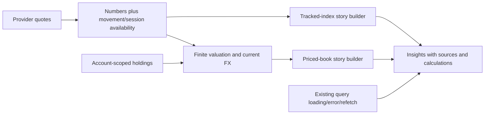
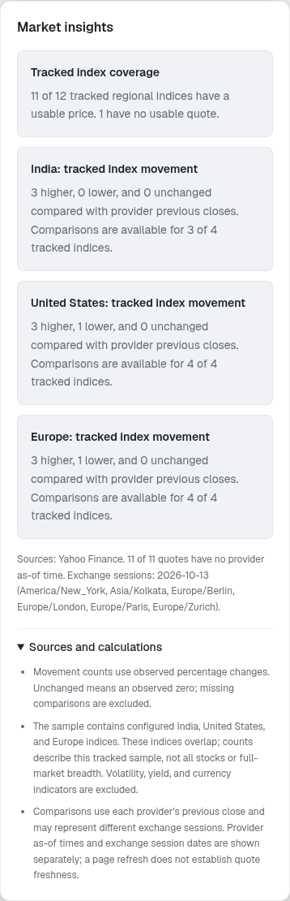
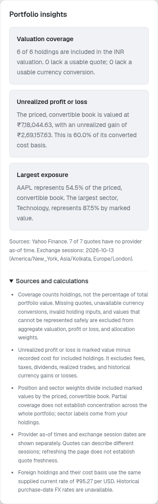

# Market and portfolio stories — engineering and validation

The user chose market and portfolio insights from actual data. The implementation
uses existing quote and holding queries; it adds no narrative AI service, new
dependency, broker action, database migration or model tuning.

## Findings, decision and data contract

The former market summary counted zero change as higher, included non-index
indicators and called different provider sessions today. Missing comparisons
were collapsed into numeric zero. Portfolio quote errors were hidden, invalid FX
could pollute valuation, and zero cost basis could look like a zero percentage
return. Root cause: aggregation/presentation lacked data-availability contracts.

Five whys: misleading counts used numeric defaults; those defaults collapsed
missing comparisons; quote types lacked availability; independent holdings and
quotes queries hid quote failure; tests did not distinguish unknown from unchanged.
The engineering review was recorded before implementation in the execution
workspace at `/workspace/.setup/data-stories-review/engineering-review.md`.

We chose additive `changeAvailable`/`changePercentAvailable` flags, deterministic
builders and a shared accessible section. Zero means an observed flat move only
when availability is known. A single historical bar has no previous-close
comparison. Provider timestamps and exchange session dates remain separate;
page/response receipt time is not quote freshness.

Market stories cover the configured India/US/Europe index sample, excluding
volatility/yield/currency indicators. They report configured quote coverage and
higher/lower/unchanged/unknown comparisons. Overlapping indices and cross-session
quotes do not establish full-market breadth or explain why prices moved.

Portfolio stories describe the priced, convertible book: included holdings,
unrealized profit/loss, largest position and sector exposure. Missing quotes,
unavailable FX, invalid holding inputs and unrepresentable math are excluded
explicitly. Foreign marked value and cost use the same current USD/INR rate;
this is not historical FX-inclusive or realized performance. Fees, taxes and
dividends are excluded. Zero cost basis leaves percentage P&L unavailable.

Valuation remains available when a daily comparison is unknown. Complete
aggregate session change requires a finite, positive comparison baseline for
every included position. Independent review caught a two-position case where
one valid holding masked another's invalid baseline; the fix preserves current
value and allocation while suppressing that aggregate change.

## Architecture and changed files

| Files | Purpose |
|---|---|
| `src/lib/insights/stories.ts` and tests | Pure tracked-index and priced-book calculations, coverage/source contracts |
| `InsightsStories.tsx` and tests | Shared headings/cards, loading/error/retry and native methodology details |
| Market overview/portfolio pages and tests | Integrate stories; show unavailable values neutrally and preserve holding editing during quote failure |
| Portfolio summary/tests | Finite FX/input/math, exclusions, nullable cost-basis percentage and valid per-position comparison baselines |
| Public market/news hooks and regressions | Reattach pending public requests after successful identity hydration clears the cache |
| Portfolio hook/tests | Expose quote loading/error/refetch and provenance without changing account/mutation isolation |
| Market types/normalization/tests | Add movement availability; avoid ranking unknown/nonfinite comparisons |
| ML market-data route/test | Mark a one-session quote's previous-close comparison unavailable |
| Dashboard layout and initial page motion | Keep initial server/client markup consistent for reduced-motion browsers |

Security: existing account-specific query keys and mutation ownership checks
remain intact. Stories introduce no extra fetches or private-data sharing.
Public query keys subscribe to the current user identity so successful sign-in reattaches queries after AuthSync clears the cache. Request URLs remain public; private cache clearing and stale-profile guards are preserved. A pending query stays in a loading state instead of briefly reporting no quotes. Initial profile failure with an unchanged null identity remains a follow-up in [issue176](https://github.com/aaron-seq/Roneira-AI-HIFI/issues/176).
Performance is linear over fetched instruments/holdings. Reverting the slice
removes the stories/additive fields; there is no schema or data migration.

## Runtime setup and known limits

A disposable local PostgreSQL17/GoTrue/PostgREST/Kong stack was set up using
verified cached image digests, with only gateway54321 published on loopback.
It applies 75 real Auth migration versions and all 11 repository migrations
(001–012, no004 file). Optional committed demo/admin holdings are synthetic
integration fixtures. Database/gateway state is temporary; generated local
credentials stay in runtime memory/container configuration, and no pasted
hosted credentials are copied into files.

Twelve local checks passed: real signup, signin/refresh/getUser/logout, SSR
cookies, owner/cross-user/anonymous RLS, role/RPC restrictions, private
watchlist/audit data, committed alert rollback/RLS assertions and ML readiness.
Auth admin hard-delete still returns500: `audit_log.user_id ON DELETE SET NULL`
conflicts with migration009's append-only update trigger. This is tracked as
[issue174](https://github.com/aaron-seq/Roneira-AI-HIFI/issues/174); its guard
was not weakened. This failure is distinct from the passed component workflow.

Storage, Realtime, Studio, SMTP and OAuth are omitted; current notifications
use HTTP polling. No hosted authentication/deployment, user portfolio or
upstream provider credential validity is established by local fixture checks.
Provider/hosted key values still need secure environment bindings.

The tested install/start instructions and variable requirements are saved in
the cloud environment draft. Saving a draft does not apply values or publish
the snapshot; review/save environment settings and publish through the product.

## Validation and reproduction

The current suites pass 312 web tests and 202 ML tests, plus lint, type checks and the production build.
Financial regressions cover signed/flat/unknown comparisons, missing quotes, invalid
FX/holdings, overflow, zero cost basis, partial-book denominators and the mixed
invalid comparison baseline. Hook/page tests cover loading, quote failure/retry,
account isolation and editable holdings during unavailable valuation.

Real local browser checks passed 25 states and 10 flows. Sixteen story states cover market/portfolio at 320/390/768/1440 pixels in
both themes with zero detected WCAG A/AA findings or horizontal overflow.
Dashboard routes rendered; actual login, holding create/edit/delete, watchlist
alert save, authenticated prediction, injected quote failure/retry and role-protected
admin checks passed. Browser data uses synthetic committed holdings with actual
Yahoo quote responses; a separate injected provider error is labelled as a fixture.
Anonymous signup rendering was checked separately from authenticated signup redirection. No page exceptions or React hydration errors remained after initial motion fixes. Independent review covered valuation baselines, provider provenance, account isolation and the public-query hydration fix.
The captured snapshot had usable prices for 11 of 12 configured regional indices and all six synthetic holdings; missing coverage remained explicit. Yahoo daily data exposed exchange session dates, with provider as-of time unavailable.

Evidence is preserved under `/workspace/.setup/data-stories-review/`.

Run the documented root lint/type/web/build commands and the ML pytest suite.
Local integration uses the saved disposable setup instructions; ordinary application
startup does not seed or migrate a hosted project. Revert the complete stories slice
to roll back; no migration reversal or user-data change is required.
