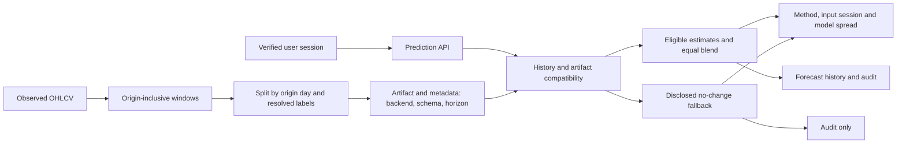
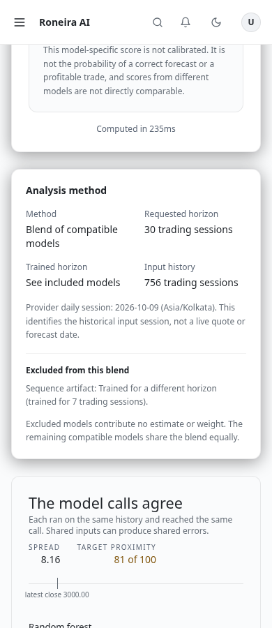
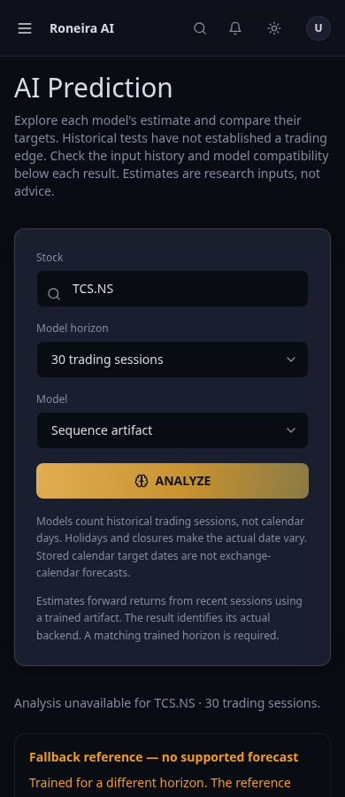

# Model contracts and analysis design review

Prepared against `69ffd6696dfee6fc4cd51e4152ea5dba22c2b290`; verification completed
on 2026-10-13. The engineering brief requires investigation, a review before
implementation, financial-invariant tests and evidence before performance claims.
The pre-implementation review is preserved in the execution workspace at
`/workspace/.setup/ml-design-review/engineering-review.md`.

## Findings and decision

Known defects: training windows ended one session before their label origin;
inference included the current origin. Fixed 30-session artifacts were used for
every requested horizon. Validation estimated label lifetime with calendar days,
could split a shared origin date and hid negative baseline skill. Feature mismatch
was silently padded/truncated. The API discarded fallback provenance and the
ensemble rewarded agreement without measured calibration. RF could anchor an older
feature vector to the current close. The web prediction endpoint checked the user
only after inference, permitting anonymous CPU fits.

Five whys: targets were wrong because windows and labels had different origins;
training and serving reused helpers with different endpoint conventions; tests
repeated those helpers instead of verifying an origin invariant; artifact metadata
was descriptive rather than enforced; prediction contracts were not checked across
training, evaluation, serving and presentation. The root cause was an incomplete
contract for the model task and its data availability.

Unknowns include usefulness on unseen equities, stability across other regimes,
calibrated uncertainty and net strategy results. The user's Indian-equity swing
research goal informs the diagnostic; it does not authorize inferred entry/stop,
position sizing or broker execution. API aliases retain their explicit observed
session counts to preserve compatibility. Stored calendar target-date semantics
remain issue #157.

We chose incremental contract fixes and native accessible controls, with no new
dependencies, database migrations or model-family rewrite. Linear horizon scaling
and relabelling an old artifact were rejected because neither validates a different
target. Optional unvalidated TensorFlow code was removed and its training entrypoint
now gives an explicit error. The supported gradient-boosted slots were retrained.

## Resulting flow

Artifact and metadata both bind `origin-inclusive-v2` and the trained session
horizon. Strict feature/window and finite-output checks reject invalid inference.
Validation holds UTC origin days together and requires each training label to
resolve strictly before validation starts; signed skill preserves worse-than-baseline
results. Readiness requires a compatible loaded bundle. Unsupported members receive
no ensemble weight or proximity mark, and no agreement score premium is added.

The analysis screen explains each model choice, actual backend, requested/trained
sessions, history length and provider daily session. This date identifies historical
input rather than a live quote. Fallback states show a neutral reference and suppress
forecast charts/signals. Older responses disclose missing provenance. Native controls,
semantic theme colors and responsive labels support keyboard/mobile use.

## Changed files and purpose

| Area | Files | Purpose |
|---|---|---|
| Training contracts | `gradient_boost.py`, `artifacts.py`, `lstm.py`, `gan.py` | Causal windows, exact purging, strict bundle compatibility and no-change fallback; remove dormant unvalidated neural pipeline |
| Serving | `main.py`, `horizons.py`, `random_forest.py`, `ensemble.py` | Shared bounded history, input/session provenance, fresh-origin guard, compatible blend and safe exclusions |
| Maintenance | `train_models.py`, four bundled model/metadata files | Retrain nine-ticker, ten-year, 30-session artifacts; record dataset hashes and actual validation dates |
| Evaluation | `backtest.py`, validation report/JSON | Coverage-aware fixed-origin diagnostics and resolved-label weighting |
| Web boundary | prediction route, request validation, shared prediction types | Authenticate before inference, preserve provenance and keep fallback out of forecast history |
| Interface | prediction page, `AnalysisMethod`, `ModelSpread` | Descriptive selection, readable provenance/fallback and included/excluded comparison |
| Tests | training/model/backtest/API/provenance/page tests | Financial and operational invariants, auth isolation, compatibility and UI states |
| Tooling/docs | Vitest config, README, architecture, contributing, deployment, model guide | Remove deprecated config syntax and document verified behavior/reproduction/rollback |

## Validation and limits

- 233 web tests and 201 ML tests passed; lint, type checking and production build passed.
- Meaningful regressions cover suspension-stretched labels, shared-date grouping,
  origin alignment, wrong shapes/horizons, mixed artifact/metadata, malformed metadata,
  finite predictions, fallback coverage, stale RF origins and rejected/anonymous sessions.
- Chromium: 40 research states across 320/390/768/1440 widths and both themes;
  zero detected WCAG A/AA violations, page errors or horizontal overflow. Two actual
  keyboard analysis flows passed. Browser fixtures use synthetic data and real components;
  these checks do not verify hosted Supabase authentication or persistence.
- Real Yahoo input exercised the private API for TCS.NS: 30-session ensemble (four
  members), seven-session ensemble (three), unsupported seven-session sequence fallback,
  30-session second artifact, and 180-session RF. Auth rejection and readiness passed.
- The [fixed Indian-equity diagnostic](ml-validation-2026-10-11.md) used identical
  cached inputs and forecast origins. Accuracy was mixed: the 30-session refitted
  blend narrowly improved, while the seven-session blend worsened. No trading edge
  or cost-adjusted performance is established. Final RF guard preserved all 96
  recorded predictions and coverage.
- The nine-ticker bundled artifacts' separate purged held-out skill is negative:
  sequence slot approximately -0.114, second slot -0.093. Their metadata exposes
  this result. That validation is distinct from per-fold Indian-equity refits.
- One existing Starlette/httpx deprecation warning remains tracked in #149.

Security: session validation precedes expensive inference; service-token/rate-limit
boundaries remain in place. Joblib loads trusted local artifacts only. No secret
values were copied into tracked files. Performance: serving bounds the longer history;
offline training stays offline. No parameters/weights were tuned to the diagnostic.
More history can increase fit cost; the web timeout remains 30 seconds.

## Reviewable design examples

These screenshots use synthetic component fixtures, not live holdings or forecasts.

## Run, rollout and follow-up

Use the documented Python virtual environment, then `npm run lint`,
`npm run type-check`, `npm run test:web`, `npm run build`, and
`cd ml && python -m pytest tests -q`. Explicit retraining:
`python train_models.py --models all --backend gradient-boost --period 10y --horizon 30`.
Do not retrain as an environment-startup side effect.

Ship code, UI, model files and metadata together. Reverting the complete change restores
the previous artifact contract; no schema/data migration is needed. Broader validation,
calendar deadlines and a journal/risk planner remain #145/#157/#147/#163. RSI boundary
handling is #172; the current guard already prevents stale-origin forecasts.
The retired optional GAN loop supersedes #167. Auth and contract defects are #170/#171.
