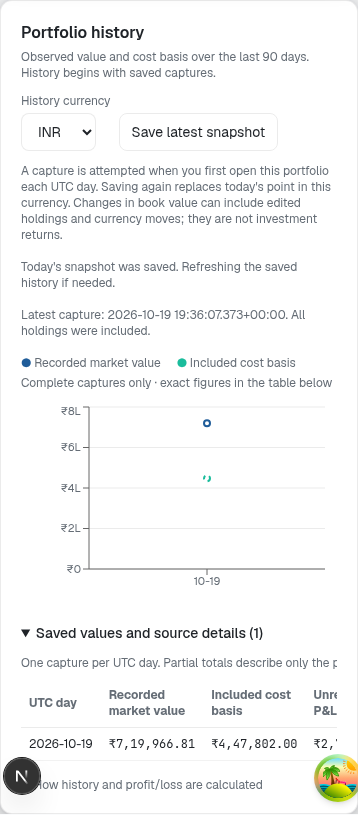
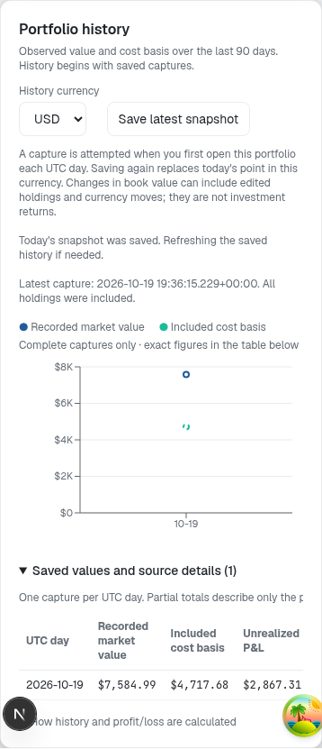

# Recorded portfolio history

Portfolio history adds observations of an account's current priced book. It does
not reconstruct unrecorded trades or calculate cash-flow-adjusted investment
returns. Product requirements are in the [portfolio PRD](product/portfolio-prd.md).

## Observation contract

Each account/currency has one capture per UTC calendar day. A new save replaces
that day's observation only when its capture time is not older than the stored
one. Missing days remain missing. INR and USD histories are separate.

A capture contains aggregate current marked value, included current holding cost
basis, unrealized P&L, percentage of positive basis, holding coverage, exclusions,
USD/INR when usable and provider/session metadata. It does not retain every
position's historical quantity, price or basis. It therefore cannot independently
reconstruct the historical book or establish a transaction ledger.

Three kinds of time stay separate:

- `holdingsObservedAt`: when the server observed the current holdings read.
- `capturedAt` / `valuedOn`: when the calculation was recorded and its UTC day.
- Source timestamps/session dates: the quote/FX observations, which may be older
  and may represent different exchange sessions. Missing provider as-of time is
  not replaced by capture time.

The server reads the book, fetches prices and rechecks a fingerprint before
saving. An edit detected during the quote request returns 409. This is a
best-effort observed-book check, not a transaction covering a broker ledger and
all market data at one atomic instant.

## Financial rules

The existing finite-value portfolio calculator is shared with current valuation.
Prices must be usable, FX finite and positive, quantities positive and costs
nonnegative. Quote currencies must match the holding denomination; USD/INR is
INR per USD. Known symbol metadata is used consistently for direct requests and
configured market groups.

Included cost and marked value use the same capture-time FX rate. Missing quotes,
conversion, invalid input or unsafe math exclude that holding explicitly. Partial
totals cover only the included subset. An empty book is zero; a nonempty fully
unpriced book is unknown. Zero cost basis permits monetary P&L but no percentage.

Unrealized P&L is marked value minus included current holding cost basis. It
excludes realized gains, cash flows, fees, taxes, dividends and historical FX
performance. Deposits, edits and changed positions can alter value between
captures without an investment gain.

## API and persistence

- `GET /api/portfolio/history?currency=INR&days=90`: authenticated owner history,
  currency INR/USD and 1–365 days. Default is INR/90. Duplicate/unknown parameters
  fail 400. Responses are private/no-store.
- `POST /api/portfolio/history` with only `{"currency":"INR"}`: authenticates,
  reads that user's holdings, obtains quotes/FX and calculates the capture on the
  server. It accepts no totals, target account, prices, date or backfill input.
- POST supports at most 200 holdings, has a per-user rate-limit bucket, rejects
  changed books with 409, and reports unavailable storage/configuration rather than a
  successful empty history. A lost response does not prove a write failed;
  refresh history before deciding what was saved.

Apply migration 013 before deploying the route/UI. The table
`portfolio_valuation_snapshots` has owner-only SELECT under RLS. Normal clients
cannot insert/update/delete it or execute the saving function. Server writes use
the service credential only after a real session has selected its own book.

`save_portfolio_valuation_snapshot(JSONB)` uses an ordered conflict update. If an
older request reaches the database late, it returns the already-newer stored row
rather than overwriting it. SQL constraints preserve finite values, valid
counts, matching UTC dates and unknown/empty/partial distinctions.

## Client behavior

The account-scoped history query/mutation observes an identity epoch as well as
user ID, so a batched A→B→A change invalidates old work while allowing new reads and
saves. Session checks run before requests and stale responses are rejected.

Opening the portfolio attempts a capture when today's entry is missing, with at
most one automatic attempt per client/account/currency/day. Failures do not
create render/retry loops. Explicit save and refresh actions remain available.
There is no unattended daily scheduler. A visit-free day is not backfilled.

The history chart includes only complete captures and breaks across missing or
partial dates. The exact-value table retains partial/unknown rows, coverage,
exclusions, source dates and FX. Current holdings remain editable during a history
storage error. Amounts are not labelled as investment returns.

## Validation and limits

The implementation was reviewed independently, including out-of-order captures,
A→B→A recovery, strict source-time handling and finite/partial financial math.
Original market-helper regressions were retained alongside new direct-symbol FX
and normalization-to-capture tests. The local stack applies 12 application
migrations and passes 13 setup checks including real Auth/RLS/SSR and the committed
history SQL assertions. Known Auth hard-delete failure remains
[#174](https://github.com/aaron-seq/Roneira-AI-HIFI/issues/174), distinct from these
passed checks.

The final suite has 397 web tests, 224 ML tests and 18 data-project tests; lint,
type-check and production build pass. Local browser testing covers 16 currency/
viewport/theme states and 8 flows using public synthetic holdings and actual Yahoo
quotes. It checks unauthorized/forged requests, daily idempotency, currency
series, failure/retry, second-account isolation, overflow and accessibility.
The final live mixed-currency capture included all six fixture holdings in
both currencies; raw provider availability remains environment-dependent.

CI checks web/ML/data behavior and builds. Real database SQL/Auth/browser checks
were run in the disposable development environment; automated database release
gates remain follow-up [#188](https://github.com/aaron-seq/Roneira-AI-HIFI/issues/188).
Hosted database/deployment and provider commercial permissions are not established
by local fixture checks. Source rights are discussed in the [data project](../data/README.md).

## Rollout and rollback

Deploy migration 013, verify grants/RLS and ordered-save assertions, then deploy
API/UI and check authenticated capture/read behavior against the intended target.
A rollback removes the UI/API integration first and retains private snapshot
rows/additive schema. Do not drop user history to roll back a visual change.

A complete ledger, realized P&L and proper investment-return attribution require
[#182](https://github.com/aaron-seq/Roneira-AI-HIFI/issues/182) and
[#147](https://github.com/aaron-seq/Roneira-AI-HIFI/issues/147). Do not relabel these
aggregate observations as that future accounting system.
